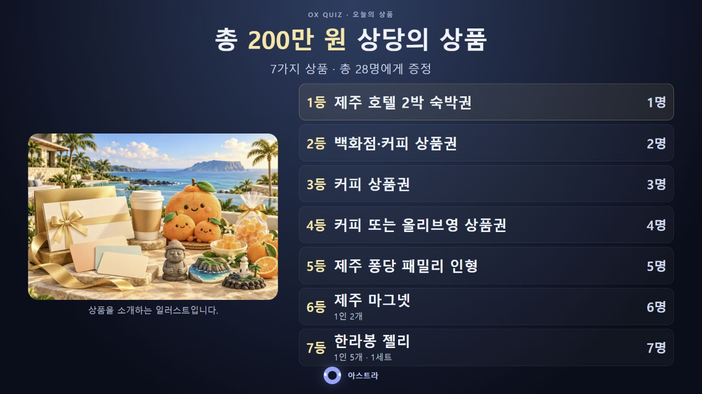

# 상품 소개 및 첫 문제 화면 검증

## 대상과 검증 범위

최종 `OX퀴즈.html`(3,787,270바이트)을 확인했다. SHA-256은 `e278d8cc6153f5a93cf061532d2789b7b69f59247b767d50908e5dc6c05f8a15`다. 이번 작업은 화면 검증과 증거·문서 갱신이며 실행 코드와 HTML을 수정하지 않았다.

관리자 화면은 HTML 한 파일을 제공하는 `http://127.0.0.1:4179/`에서 실제 UI 버튼으로 조작했다. 브라우저 크기를 1366×768로 설정하고 수동 낭독 모드의 시작·완료·다음 큐를 확인했다. 자동 TTS/녹음의 실제 종료 이벤트와 음성 품질은 이번 검증 범위에 포함하지 않는다.

프로젝션 크기 검증은 실제 관리자 `#preview`의 출력 HTML과 `head > style`을 읽어 `.projection` 본문으로 렌더링한 **정적 출력 스냅샷**으로 수행했다. 이는 별도 프로젝션 창에 쓰는 동일한 화면 구조·스타일의 크기별 렌더링 검사다. 별도 팝업 창 연결·실시간 동기화나 실제 빔프로젝터 연결을 확인한 결과로 확대하지 않는다. 실행 HTML의 상품 이미지와 같은 PNG 원본을 data URI로 넣었다. 작업용 HTML은 Git 제외 대상인 `data/qa-2026-10-21/`에 보관했다.

## 화면 결과

| 화면 / 크기 | 결과 | 관찰 근거 |
|---|---|---|
| 관리자 1366×768 | 통과 | 상품 이미지 정상 로딩, 7등급·28명·총 200만 원 표시. 미리보기 안의 상품 목록·이미지·제목·인원 잘림과 가로 넘침 없음 |
| 상품 프로젝션 1280×720 | 통과 | 페이지 높이 720px, 7개 상품 행 모두 내부 넘침 없음. 7등 마지막 행 하단 약 668.5px로 화면 안에 위치 |
| 상품 프로젝션 1920×1080 | 통과 | 페이지 높이 1080px, 제목·인원·이미지·7개 행·공동사회자 표시 모두 화면 안에 위치. 가로 넘침 없음 |
| 1번 문제 프로젝션 1280×720 | 통과 | 문제·O/X·손 방향·대본 자막 표시. 페이지 높이 720px, 마지막 자막 하단 약 662.9px, 가로 넘침 없음 |
| 1번 문제 프로젝션 1920×1080 | 통과 | 페이지 높이 1080px, 문제·보기·대본 표시, 가로 넘침 없음 |

관리자 페이지는 제어·설정 패널 때문에 세로 스크롤이 있는 구조다. 전체 미리보기가 노트북의 한 화면에 동시에 들어간다는 뜻은 아니며, 전체 페이지 캡처와 DOM 경계로 미리보기 자체의 내부 잘림이 없음을 확인했다. 프로젝션 출력에는 위 두 크기에서 세로 스크롤이 생기지 않았다.

## 실제 관리자 UI 진행 결과

1. 초기 대기 화면에는 상품 소개가 나오지 않는다.
2. **다음 · 시작 인사 읽기**를 누르면 상품 소개 화면과 수동 낭독 완료 버튼이 나온다.
3. **낭독 완료**를 누른 후에도 상품 소개가 유지된다. 큐 버튼은 **다음 · 1번 문제 읽기**로 바뀌고 타이머·정답은 나오지 않는다. 다른 화면 크기 검증을 수행한 뒤에도 같은 상품 화면이 유지됨을 재확인했다.
4. **화면 가리기**는 검은 화면으로 전환하고 **화면 다시 켜기**는 상품 소개를 복원한다.
5. **다음 · 1번 문제 읽기**를 누르면 상품 소개가 사라지고 1번 문제·O/X·손 방향이 표시된다. 낭독 완료 전에는 타이머 숫자와 정답이 나오지 않는다.
6. **낭독 완료 · 타이머 시작**을 누르면 10초 타이머가 시작된다. 타이머가 끝난 뒤에도 정답은 공개되지 않고 다음 큐를 기다린다.
7. 추가로 4번 문제 선택·공개 시 해피 이미지 정상 로딩과 정답 비노출을 확인했다. 시작 화면으로 복귀하면 문제 이미지와 상품 소개가 사라진다.

검사 중 큐를 650ms 이내에 연달아 누르면 두 번째 입력이 무시되는 기존 중복 방지 동작도 관찰했다. 간격을 둔 다음 입력에서 타이머가 정상 시작했다. 관리자 콘솔 오류·경고 로그는 조회 결과 0건이었다. 종료 시 1번 문제 위치·초기 화면·음성 읽기 켜짐을 복원하고 임시 브라우저 크기 설정을 해제했다.

## 캡처

- [노트북 상품 소개 — 낭독 완료 후](laptop-1366x768-intro.jpg)
- [노트북 첫 문제](laptop-1366x768-question1.jpg)
- [노트북 4번 해피 이미지](laptop-1366x768-question4.jpg)
- [상품 프로젝션 1280×720](projection-1280x720-intro.jpg)
- [상품 프로젝션 1920×1080](projection-1920x1080-intro.jpg)
- [첫 문제 프로젝션 1280×720](projection-1280x720-question1.jpg)
- [첫 문제 프로젝션 1920×1080](projection-1920x1080-question1.jpg)
- [1080p 상품 화면 DOM 측정](projection-1920x1080-measurement.json)

## 남은 운영 확인

실제 행사 노트북에서 별도 프로젝션 팝업의 연결·실시간 동기화·리모컨 입력·F11 전체화면과 빔프로젝터 출력을 확인한다. 실제 사용할 음성과 변경된 시작 대본의 일치·낭독 종료도 별도로 점검한다. GitHub 반영·운영 배포·GPT-SoVITS 음성 제작은 이번 작업에서 수행하지 않았다.
