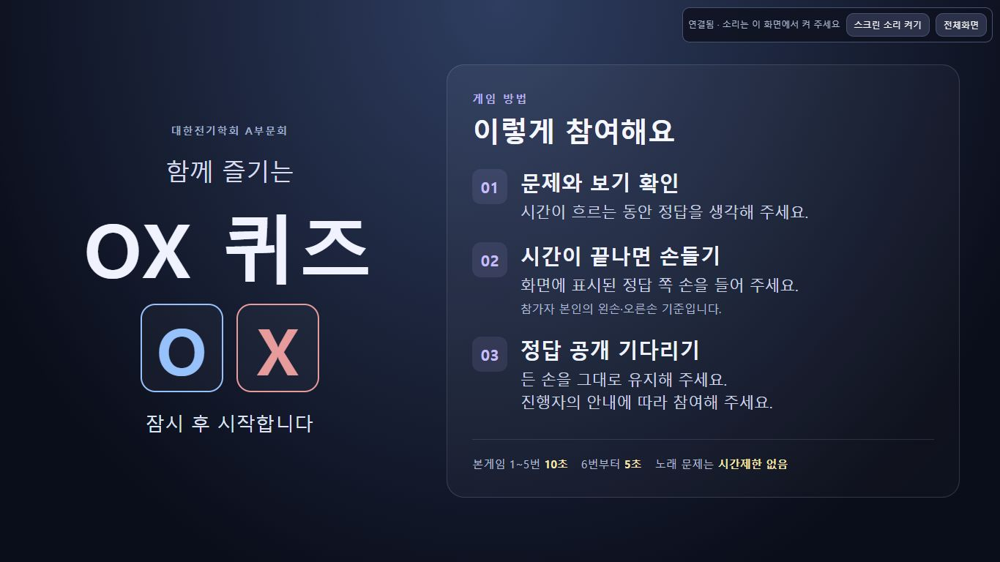

# 대문 게임 방법 안내

사용자가 대문에 게임 방법을 요청했고, 손드는 시점을 **시간이 끝날 때**로 지정했다. 공통 대문을 다음3단계로 갱신했다.

1. **문제와 보기 확인** — 시간이 흐르는 동안 정답을 생각한다.
2. **시간이 끝나면 손들기** — 화면에 표시된 정답 쪽 손을 든다. 참가자 본인의 왼손·오른손 기준이다.
3. **정답 공개 기다리기** — 든 손을 그대로 유지하고 진행자의 안내에 따른다.

본게임1~5번10초·6번부터5초·노래 문제 시간제한 없음도 함께 표시했다. 손 방향은 문제별 화면을 따르며 O/X를 한쪽 손에 고정하지 않았다. 탈락·경품 지급 규칙을 새로 정하지 않았다.

## 구현 범위

`web/src/offline/presentation.js`의 대문 마크업과 `web/offline-shell.html`의 대문 전용 스타일을 수정했다. 넓은 화면은 제목과 안내를2열, 작은 미리보기는1열로 배치한다. 기존 공통 빌드로 단독 `OX퀴즈.html`과 클라우드의 관리자/프로젝션 화면을 재생성했다. 선행 모듈/계획은 [설계](../../design/manual-cloud.md)에 갱신했다.

게임 모델·문항·정답·순서·수령 명단·로그인·스크린 키·자정 예약의 구현은 변경하지 않았다. 프로젝션은 기존 공개 주소와 연결 키, 진행실은 기존 IAP/PIN을 그대로 사용한다.

## 자동 및 실제 화면 검증

| 항목 | 결과 |
|---|---|
| 최종 회귀 | 수동90/90·클라우드49/49, 총139개 통과 |
| 빌드·린트 | 단독 HTML·cloud build·ESLint 통과 |
| 노트북1366×768 | 실제 HTTPS 공개 대문3단계 및 종료 시 손들기 표시. 제목/안내/시간 설명 모두 stage 안에 있고 가로·세로 넘침 없음 |
| 프로젝션1920×1080 | 같은3단계와 시간 규칙 표시, stage 밖 항목0·가로/세로 넘침 없음 |
| 시작 전환 | 보호된 진행실에서 시작하기→상품7등급/28명/200만원 소개→첫 워밍업 문제→10초 자동 시작 확인 |
| 마지막 상태 | 본게임 첫 순서의 대문으로 복귀. 기존 공개 팝업과 로컬4179 창을 새로고침해 새 안내 표시 확인 |

실제 브라우저 해상도 검증이며 행사장의 프로젝터·스피커 또는 실제 휴대폰 기종 확인을 뜻하지 않는다.

## 운영 반영

- Cloud Build `f549282d-f2fa-48ca-a135-829531dbfde3` SUCCESS, 같은 허용 목록49파일로 두 이미지 생성.
- 진행실: `ox-manual-quiz-00004-x6f`, Ready·100% 트래픽.
- 공개 스크린: `ox-manual-screen-00002-crf`, Ready·100% 트래픽.
- 이미지 digest: main `sha256:bf01a05af730cbd59f066fe3fb2bf24a6052b5459e01cf95cd34a662f94da8b5`, screen `sha256:41c0b98a8675d903d743ea89ee06a1861995a643b9a22b003854f45288c1d3c8`.
- 전용 두 서비스의 이미지와 기존 min1/CPU 상시 설정만 명시적으로 갱신했다. 진행실 IAP 및 스크린 공개 설정은 유지했다.
- 자정 Task와 workflow는 수정하지 않았다. 기존10/23 00:00 KST의 두 서비스 min0/요청 CPU 예약이 계속 적용되며 실제 실행 결과는 미래 미확인이다.
- Git commit/push는 하지 않았다. 사용자 변경과 기존4179 서버 프로세스를 보존했다.

안전한 레이아웃·보존 영수증은 Git 무시 대상 `data/cloud-deployment/cover-guide-layout.json`과 `cover-guide-preservation.json`에 기록한다.

[프로젝션1920×1080 확인 화면](cover-guide-1920.jpg)
