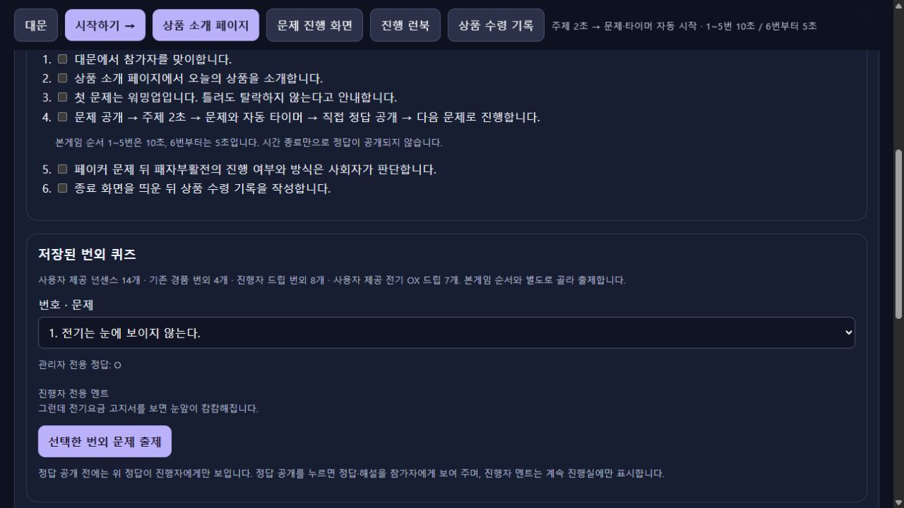
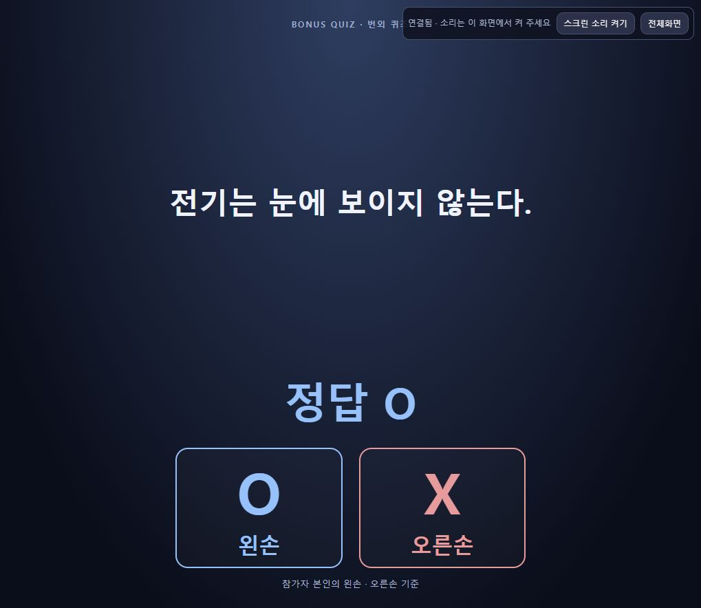
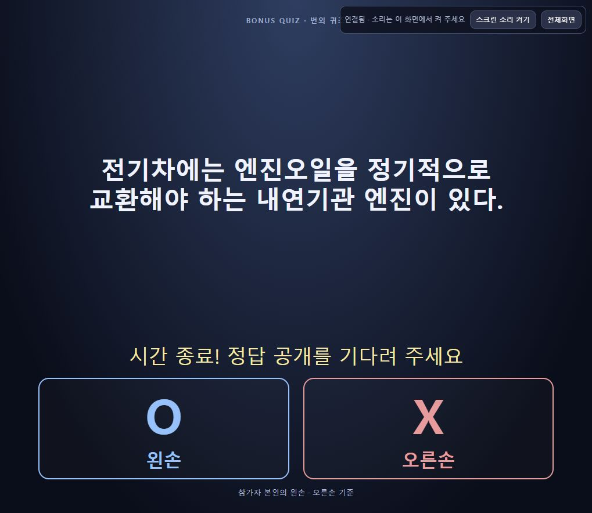
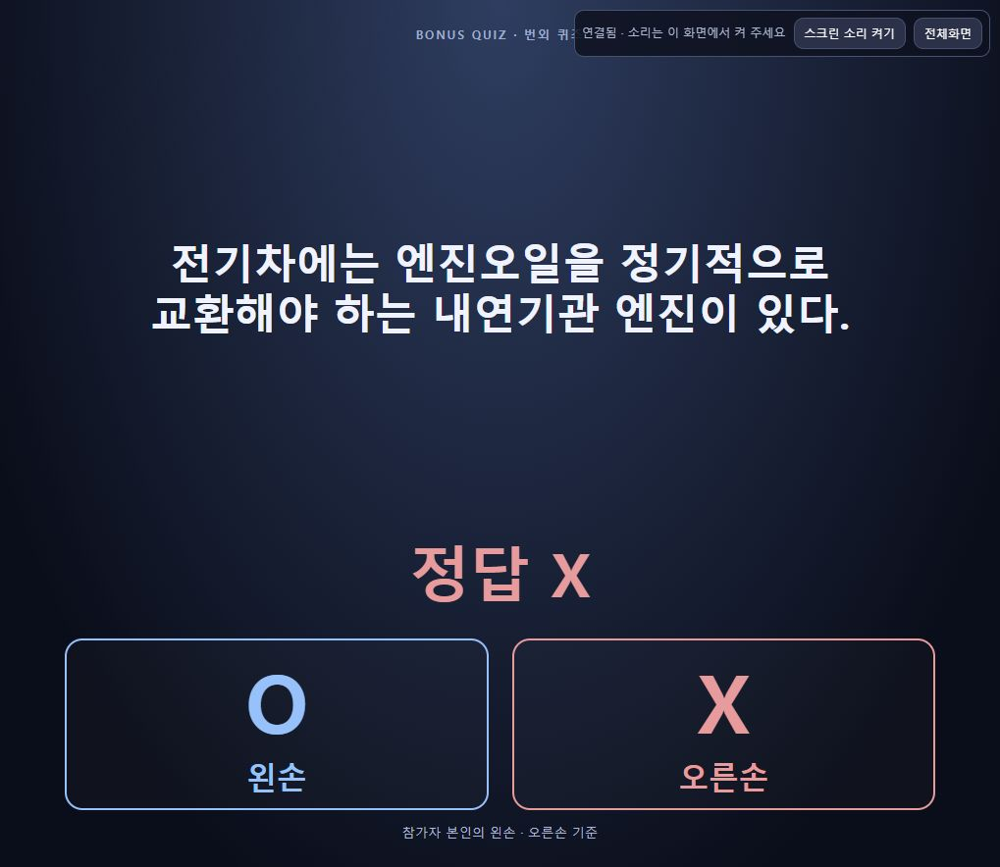

# 사용자 제공 전기 OX 드립7개 검증

사용자가 보낸7문항·정답·진행 멘트를 별도 `user-electric-ox` 그룹에 그대로 추가한다. 본게임20개와 기존 번외26개는 유지하며 전체 저장된 번외는33개다. [설계](../../design/manual-cloud.md)와 [런북](../../planning/runbook.md)을 구현 전에 갱신했다.

## 구현 완료

- `questions/bonus-quiz-2026.json`이 OX7개, 정답 O/O/X/X/X/O/X, 사용자 제공 출처와 관리자 `hostNote`를 소유한다. 문구와 멘트를 바꾸지 않았다.
- 공개 해설은 빈값으로 두고 진행 멘트를 관리자 전용 `note`로만 연결했다. 정답 공개 후에도 멘트는 스크린으로 전달하지 않는다.
- `runbook.js`는 기존 공개 함수 `createSavedRunbookQuestion(id)`를 유지하고 `source.kind: user-provided`를 새 작성 출처와 같은 표시 경로로 처리한다. 이전 원문 복원 파일/행 출처는 유지한다.
- 주제2초 → 번외5초 자동 시작 → 수동 정답 공개 → 본게임 복귀 경로는 기존 모델을 사용한다. 본게임 은행·서버/API·인증·영속 형식·공개 스크린 코드는 수정하지 않았다.
- `OX퀴즈.html`과 클라우드 진행실을 재생성했다.

## 자동·독립 검증 완료

- 수동91개 + 클라우드49개 = **140개 통과**. 기존 진행자 멘트 공개 경계 검사를 새7개까지 확장했다. 전체 ESLint와 두 빌드 통과.
- 사용자 제공 정답 순서, O/X 보기,5초, 출처 정상 표시, note 보존 및 주제/문제/정답 단계에서 멘트·출처 비노출을 확인했다.
- 별도 검토자가7개를 실제 ManualService의 메모리 저장소로 실행해 관리자 bonusQuestion의 note/source 유지와 공개 DTO allowlist를 확인했다. 이 검사는 실제 GCS/HTTPS 검증과 구분한다.
- 기존3그룹26개의 전체 JSON 내용 동일성을 SHA-256으로 비교했다: `aea645e831d7ff2e47a942e80329b2051fc510d1b31f231de41c5cbc77446fc3`.
- 로컬4179에서 새 그룹7개·1번 O 정답·요청한 전기요금 멘트 표시를 CUA로 확인했다.

## 운영 반영 및 실제 화면

진행실 이미지만 빌드·반영했다. 공개 스크린은 기존 `ox-manual-screen-00002-crf`를 유지한다.

- 프로젝트 `gridex-companyinfo`, 리전 `asia-northeast3`, Cloud Build `d2f15ce4-6e05-4b1b-80c2-37ac9e20c99c` SUCCESS, 완료 `2026-10-22T03:38:35.828315Z`.
- 이미지 `sha256:898d7af0f5d07f4cc22e215418ac84cd177330d77c1230743f3907e2fabc1446`.
- main `ox-manual-quiz-00006-889`: Ready `2026-10-22T03:39:08.175961Z`, 트래픽100%.
- allowlist 소스49개로 빌드했으며 현재 데이터·factory의 해시가 실제 제출한 소스와 일치한다. 개인 명단·키·PIN·Git·로컬 상태는 소스 패키지에 포함하지 않았다. commit/push는 수행하지 않았다.

기존 인증된 진행실과 별도 공개 스크린을 CUA로 조작했다.

1. 새 그룹7개와 사용자 원문을 확인하고1번을 선택했다. 관리자 미리보기에 정답 O와 “그런데 전기요금 고지서를 보면 눈앞이 캄캄해집니다.”가 표시됐다.
2. 1번 출제 후 주제2초 상태를 확인하고 공개 스크린에 문제/OX·손 방향이 나타나는 것을 확인했다. 타이머 만료 후에도 정답 대기 상태였으며 공개 본문에 정답 표시와 고지서 멘트가 없었다.
3. 직접 **정답 공개** 후 공개 화면에 ‘정답 O’가 나타났고 진행자 멘트는 계속 없었다. **본게임으로 돌아가기** 후1/20 대문을 복원했다.
4. 3번을 선택해 관리자 정답 X와 “엔진오일 갈아주겠다는 친구가 있으면… 친구부터 교체하세요.”를 확인했다. 출제 후 긴 문제 문장이 줄바꿈되어 OX/손 방향과 함께 표시됐다. 정답 공개 전에는 ‘정답 X’와 친구 교체 멘트가 없었다.
5. 직접 공개 후 ‘정답 X’를 확인했으며 진행자 멘트는 계속 없었다. 다시 본게임1/20 대문으로 돌아왔고, 시간 종료 시 손들기 안내를 유지했다.
6. 마지막으로 클라우드 진행실과 로컬4179는 새 그룹1번을 선택한 런북에, 공개 스크린은 본게임 대문에 두었다.

새7개 전체의 내용·정답·공개 경계는 자동/독립 검사로 확인했고 실제 운영 UI의 출제·정답·복귀는1번과3번 두 문제를 확인했다. 실제 휴대폰/현장 프로젝터·스피커 시험이나 경과시간 정밀 측정으로 확대 해석하지 않는다.

기계 판독 결과와 최신 GCS/설정/예약 보존 결과는 [검증 JSON](electric-ox-drip.json)에 기록한다. 자정 예약은 기존 `2026-10-23 00:00 KST`를 유지하며 실제 해제 완료는 예약 시각 이후 확인할 사항이다.
