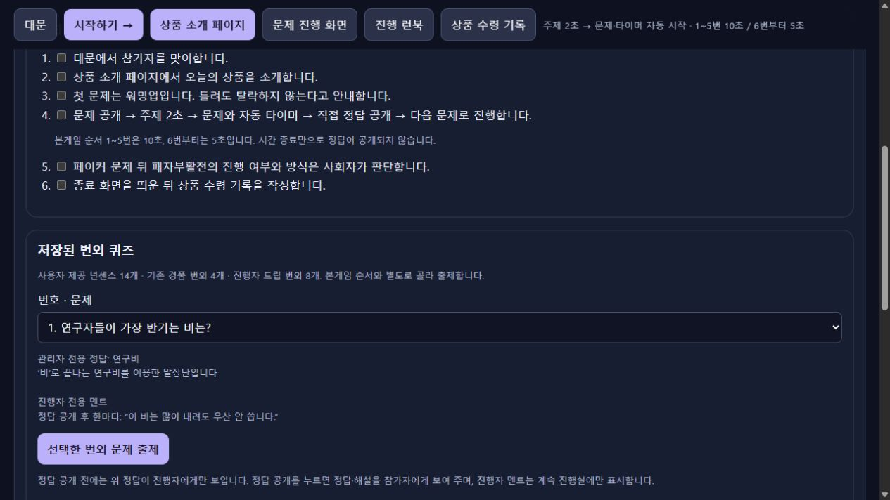
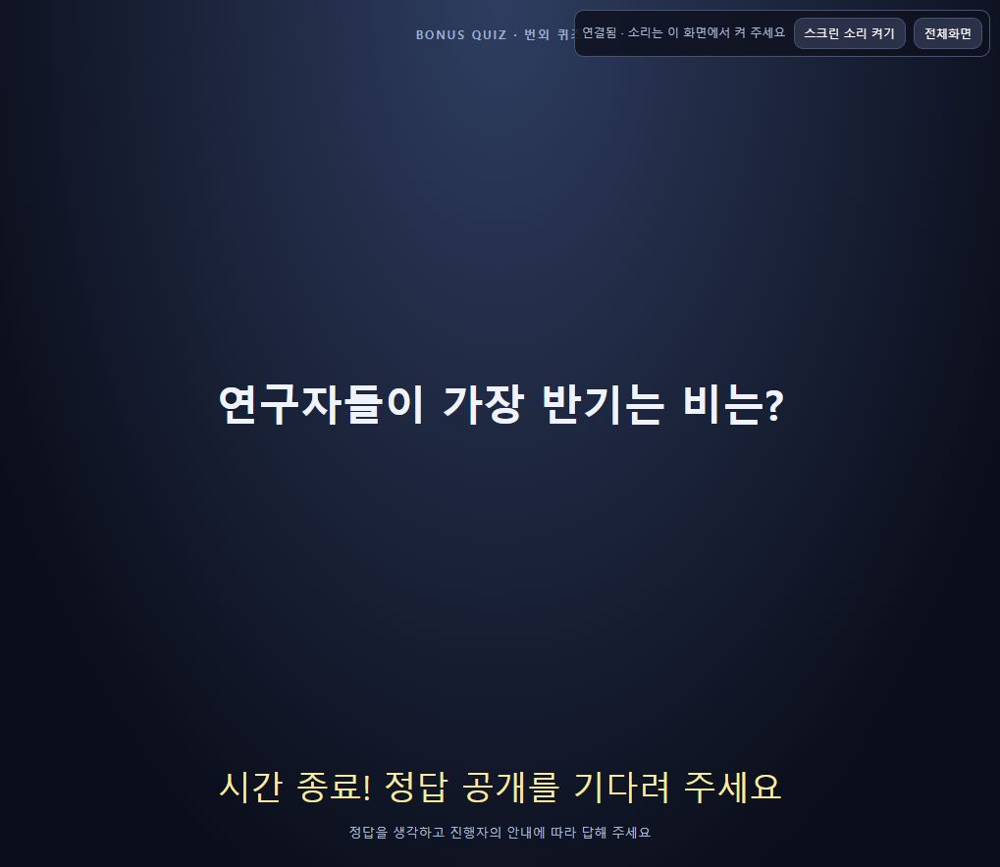
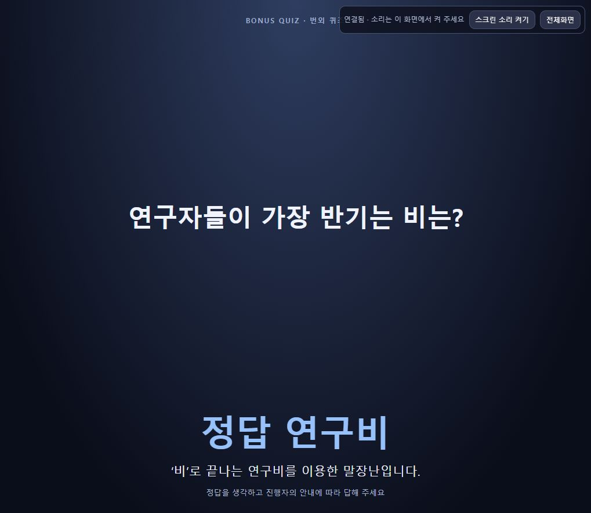

# 진행자 드립 번외 8개 검증

사용자 요청 “드립을 좀 칠만한 퀴즈를 좀 추가해줘”에 따라 연구·전기·수학 공감형과 가벼운 말장난8개를 런북의 별도 그룹으로 추가했다. 기존 본게임20개·사용자 넌센스14개·경품 번외4개를 유지한다. 내용과 멘트는 [운영 런북](../../planning/runbook.md), 책임·공개 인터페이스는 [설계](../../design/manual-cloud.md)에 기록했다.

## 구현 완료

- `questions/bonus-quiz-2026.json`: `host-drip` 그룹8개, 새 작성 출처, 공개 해설과 비공개 `hostNote`를 분리했다.
- `runbook.js`: 기존 `createSavedRunbookQuestion(id)`를 유지하고 그룹별 주제·출처, `hostNote`→관리자 `note`, 선택 미리보기의 진행자 멘트를 연결했다. 기본 선택은 기존 목록을 유지한다.
- 기존 주제2초·번외5초 자동 타이머·수동 정답 공개·본게임 복귀 모델과 공개 DTO를 재사용한다. 서버·API·인증·영속 상태 형식은 바꾸지 않았다.
- 단독 `OX퀴즈.html`과 클라우드 진행실을 재생성했다. 새 번외는 본게임 은행에 자동 삽입하지 않는다.

## 자동 검증 완료

- 수동91개 + 클라우드49개 = **140개 통과**, 전체 ESLint, 두 빌드 통과.
- 8개 각각의 고유ID·5초·관리자 멘트 유지·새 출처와 기존 원문 출처 구분을 검사했다.
- 주제/문제/정답 공개 DTO에서 `note`, `hostNote`, 출처가 빠지며 멘트가 관리자 미리보기에만 포함되는 것을 검사했다.
- 기존 두 그룹18개의 전체 내용 동일성을 SHA-256으로 비교했다: `F33D1F147E317D46A18B6983C097B8E8BE102379DF85614D202B4F3E50E0930D`.

## 클라우드 운영 반영 완료

- 프로젝트 `gridex-companyinfo`, 리전 `asia-northeast3`의 진행실만 갱신했다. 기존 환경·Secret 참조·GCS·권한·상시 실행 설정을 유지했다.
- Cloud Build `691b399e-e310-4864-af6d-41fca6c1c0ae`: SUCCESS, 완료 `2026-10-22T03:25:18.001204Z`.
- 진행실 이미지 `sha256:cbba22d9187d0c608c8d07ae8182826523d12647d0e0eba87111e3730530c8a8`.
- 진행실 `ox-manual-quiz-00005-r6x`: Ready, `2026-10-22T03:28:42.741127Z`, 트래픽100%.
- 공개 스크린 코드는 바뀌지 않아 `ox-manual-screen-00002-crf`를 유지했다. 기존 화면은 서버가 전달한 새 번외 문제를 표시했다.
- 개인 명단·PIN·스크린 키·Git·로컬 상태를 제외한 allowlist 소스49개로 빌드했다. 저장소 commit/push는 수행하지 않았다.

## 실제 브라우저 검증 완료

기존 인증된 진행실과 별도 공개 스크린을 CUA로 조작했다. 실제 휴대폰·현장 프로젝터 검증과 구분한다.

1. 진행 런북에 기존14개·경품4개·새 드립8개 그룹이 함께 표시됐다. `drip-01` 선택 시 정답 ‘연구비’와 “이 비는 많이 내려도 우산 안 씁니다”가 관리자 미리보기에 보였다.
2. **선택한 번외 문제 출제** 후 진행실이 ‘드립 퀴즈·주제2초’로 바뀌고 공개 스크린에 “연구자들이 가장 반기는 비는?”이 나타났다.
3. 타이머 만료 후에도 ‘정답 공개를 기다려 주세요’ 상태를 유지했다. 스크린 본문에 정답 ‘연구비’와 관리자 멘트 ‘우산’이 없었다.
4. 진행실의 **정답 공개**를 누른 뒤 스크린에 ‘정답 연구비’와 공개 해설이 표시됐다. 진행자 전용 멘트는 계속 스크린에 없었다.
5. **본게임으로 돌아가기** 후1/20·대문으로 돌아왔다. 시간 종료 시 손들기 안내도 유지됐다. 마지막으로 진행실은 새 번외 선택 목록, 프로젝션은 본게임 대문에 두었다.
6. 로컬4179의 재생성 HTML에서도 새 그룹·관리자 멘트가 표시되는 것을 확인하고 대문으로 돌아왔다.

새8개의 데이터/공개 경계는 자동 검사로 확인했고, 실제 운영 UI의 전체 출제/정답/복귀 흐름은 `drip-01` 한 문제로 확인했다. UI 관찰 시점의 제한시간 만료를 확인했으며 실제 경과시간 정밀 측정이나 현장 음향 시험은 수행하지 않았다.

기계 판독 결과·배포 소스 해시·최신 상태 보존 확인은 [검증 JSON](host-drip.json)에 기록한다. 자정 예약은 기존 `2026-10-23 00:00 KST`를 유지하며, 이 검증은 아직 도래하지 않은 실제 상시 실행 해제 완료를 뜻하지 않는다.
