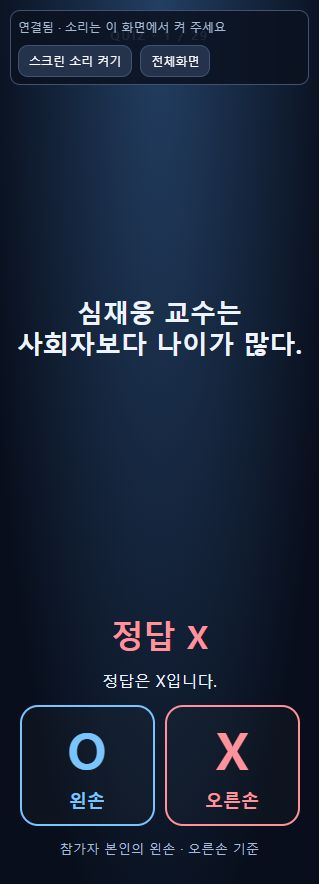
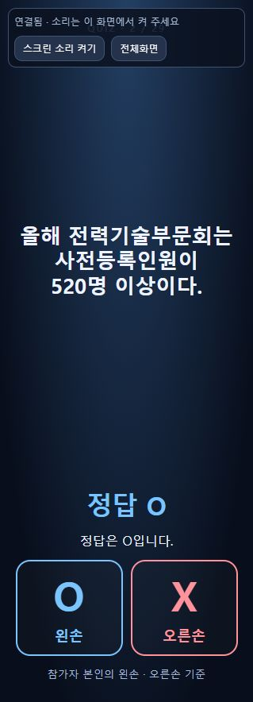

# 시작1·2번 추가와 메인29문항 검증

사용자의 두 후속 요청을 함께 반영했다.

| 번호 | 문제 | 정답 |
|---|---|---|
|1|심재웅 교수는 사회자보다 나이가 많다.|X|
|2|올해 전력기술부문회는 사전등록인원이 520명 이상이다.|O|

기존27문항은 내용·정답·사진·노래·메모/출처와 상대 순서를 유지해3~29번이 됐다. 제주어는23~28번, 전기국가는29번이며 번외33개는 그대로다. 두 새 문항은 사용자 제공 문구·지정 정답을 저장한 것으로, 실나이·생년월일·실제 등록 수를 별도로 조사하거나 추정하지 않았다.

## 설계·구현 완료

[설계](../../design/manual-cloud.md)·[런북](../../planning/runbook.md)·대시보드를 구현 전에 갱신했다. 변경은 새 문항 원본 `first-warmup-2026-10-22.json`, `second-opening-2026-10-22.json` 및 독립 offline/cloud seed의 데이터에 국한했다. 기존 모델·편집기·API·화면·인증의 공개 인터페이스는 바꾸지 않았다. 작성 원본은 빌드가 직접 참조하지 않으며 실제 데이터는 두 seed에 포함된다.

첫 주제는 기존 모델이 **워밍업**으로 고정한다.1·2번은 주제2초 후10초 자동 시작,6번부터5초·노래 무타이머 규칙을 유지했다. 두 문항 삽입으로 원래4번이 새6번, 원래5번이 새7번이 되므로 이 두 문제의 `seconds`만10→5로 정규화했다. 나머지 기존 필드와 순서는 보존했다.

## 저장·자료 보존 완료

- 실제 local4179/cloud의 기존27문항과 확장한 편집 화면을 UI 백업/읽기로 보존했다. 두 환경 모두 미저장 편집 없이 ‘저장된 문제와 순서입니다.’ 상태였다.
- 1번만 넣었던 중간28문항도 따로 백업했다. 후속2번 요청을 반영한 최종29문항을 기존 JSON 가져오기·문제/순서 저장으로 적용하고 local29 ACK·cloud29 durable ACK를 확인했다.
- 새 배포에 재로그인한 클라우드와 새로고침한 로컬 모두29문항을 유지했다. 최종 UI 백업을 다시 받아 전체29개가 `validateQuestions([새1번, 새2번, ...원래27개])`와 일치하는지 비교했다.
- 기존27개는 `seconds`를 제외한 전체 객체가 순서대로 동일하다. 시간 변경도 위 두 건만 발생했다. 원본/중간/최종 문제집과 비교 결과는 Git ignored `data/main-first-warmup/`에만 보관했다.

## 검증·운영 반영 완료

- 최종29문항에 대해 수동91개·클라우드49개 총 **140개 통과**, 단독 HTML/클라우드 빌드 통과. 데이터만 수정했으므로 JavaScript lint는 이번에 재실행하지 않았고 기존 결과와 구분한다.
- 실제 모델 전이로1번 워밍업/10초,2번10초,6번5초, 노래 문제 무타이머를 확인했다. 단독 `OX퀴즈.html`과 두 seed를29개로 재생성했다.
- 프로젝트 `gridex-companyinfo`, 리전 `asia-northeast3`. 최종 Build `5af1d88e-ee2b-4a92-8e0e-89fa446ea859` SUCCESS, 완료 `2026-10-22T07:52:05.399622Z`.
- 최종 이미지 `sha256:03c8c1a46c3b086b912fc72630f1de2551ba0408c1467128be0b0fbd923652a0`, main Ready `ox-manual-quiz-00009-5mp` (`2026-10-22T07:52:37.443209Z`), 트래픽100%.
- 두 seed의 현재 SHA-256이 제출 allowlist 소스49개 패키지와 일치한다. 개인 명단·PIN·키·Git·로컬 상태는 빌드에 포함하지 않았다. 공개 screen `ox-manual-screen-00002-crf`는 재배포하지 않았다. commit/push는 수행하지 않았다.
- 중간28개 배포 `00008-k7w`는 후속2번 요청 전 이력이며 위29개 배포로 대체됐다.

## 실제 운영 UI 검증 완료

CUA로 기존 클라우드 진행실과 별도 공개 스크린을 조작했다.

1. 최종 배포에 재로그인해29개·첫 두 문항을 확인했다.
2. 1번 공개 후 진행실에 **워밍업·주제2초**가 보이고 공개 스크린에 **QUIZ · 1 / 29**·사용자 문구·**10초**와 O/X 손 보기가 나타났다. 만료 뒤에도 정답 대기를 유지했고 직접 공개 후 **정답X**가 표시됐다.
3. 다음 버튼이2번의 **행사 상식·주제2초**로 이어졌다. 공개 스크린에 **QUIZ · 2 / 29**·사전등록520명 문구·**10초**가 나타났고 만료 뒤 직접 공개 후 **정답O**를 확인했다.
4. 다음 버튼이3번의 기존 AI 문제로 이어졌다. 과학 주제·10초·딥러닝/침수 선택지가 유지됐다. 이후1번 대문으로 복원했다.
5. 관리자 `note` 문장은 정답 공개 전후 스크린에 없었다. 로컬 새로고침에서도29개와 첫 두 문항을 확인하고, 두 환경의 최종 문제집을 UI에서 다시 다운로드해 전체 내용을 비교했다. 마지막 편집 상태도 적용 은행과 동일했다.

실제 브라우저 화면·자동 카운트다운 표시를 확인한 결과이며 정밀 시간계측·실물 휴대폰/프로젝터·현장 음향 시험과 구분한다. 전체29개를 모두 출제하는 리허설은 수행하지 않았다.

최신 GCS29개·수령 기록·음향/키·가동/접근 설정·기존 자정 예약의 before/after 보존 감사와 해시는 [검증 JSON](main-first-warmup.json)에 기록한다. 자정 실제 실행 완료는 이후 별도 확인 범위다.
