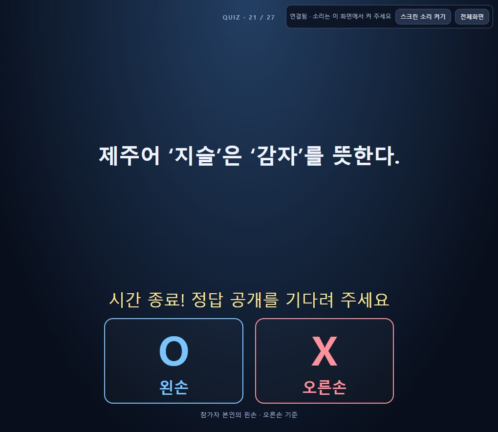
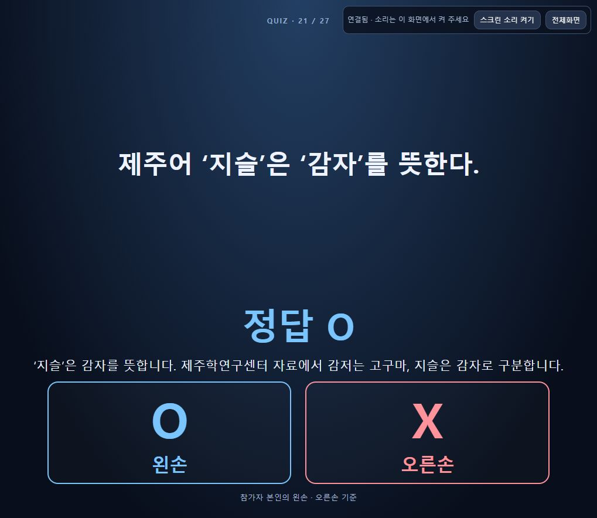
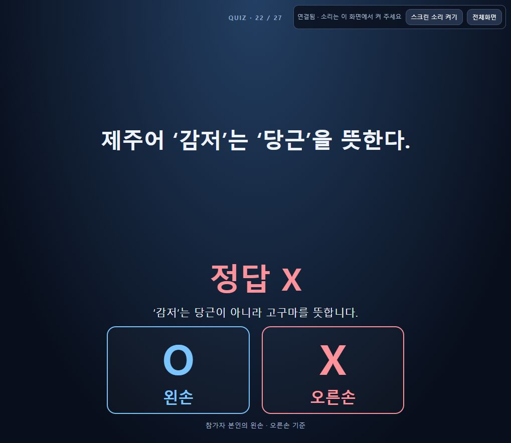
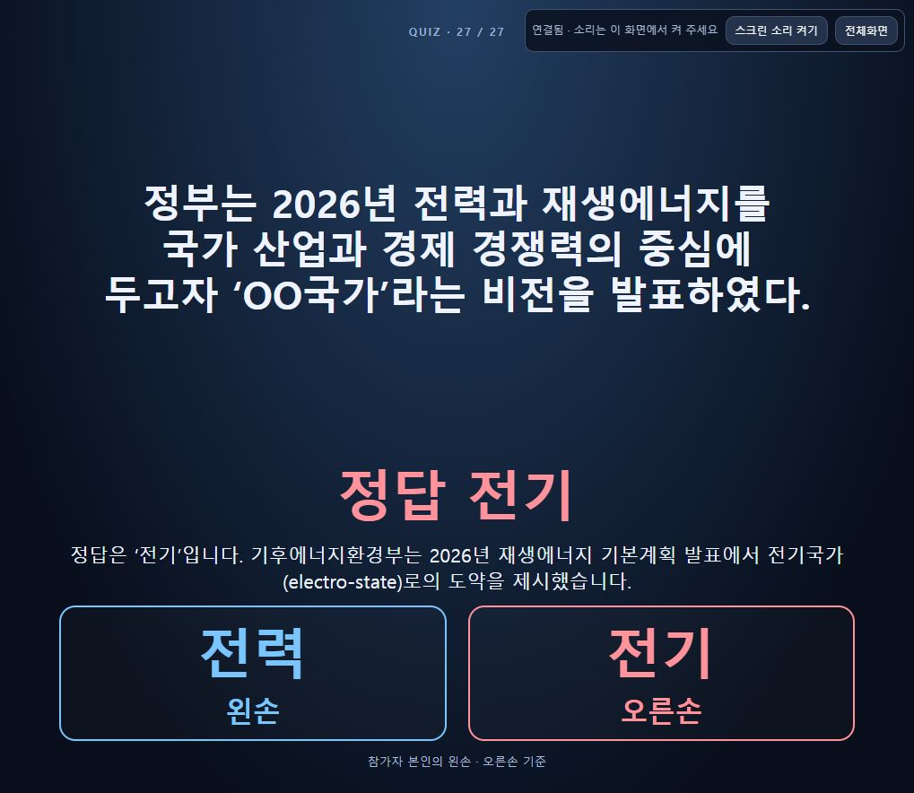

# 메인 제주어6개·전기국가1개 추가 검증

사용자가 제주 방언 문제를 **번외가 아닌 메인 OX**에 넣도록 지정했고 이어 ‘전기국가’ 문제와 클라우드 반영을 요청했다. 기존 메인20문항 뒤 제주어6개·정책1개를 붙여27문항으로 저장했다. 기존 번외33개는 바꾸지 않았다. [설계](../../design/manual-cloud.md)·[런북](../../planning/runbook.md)·대시보드의 계획을 구현 전에 갱신했다.

## 추가 문항과 근거

| 현재 번호 | 문항 | 정답 | 공개 해설의 핵심 / 직접 근거 |
|---|---|---|---|
|21|제주어 ‘지슬’은 ‘감자’를 뜻한다.|O|지슬=감자. [제주학연구센터 구술자료](https://www.jeju.go.kr/jedu/archive/jeju.htm?act=view&seq=557)|
|22|제주어 ‘감저’는 ‘당근’을 뜻한다.|X|감저=고구마. [동일 자료](https://www.jeju.go.kr/jedu/archive/jeju.htm?act=view&seq=557)|
|23|제주어 ‘도새기’는 ‘돼지’를 뜻한다.|O|[선흘1리2017 구술 자료](https://www.jeju.go.kr/jedu/map/record.htm?page=60)|
|24|제주어 ‘강생이’는 ‘고양이’를 뜻한다.|X|강생이=강아지. [교육청 초등5학년 교재](https://www.jeju.go.kr/jedu/data/data.htm?act=view&page=16&seq=1537795) 인쇄32·35쪽|
|25|제주어 ‘혼디’는 ‘혼자’를 뜻한다.|X|혼디=함께. [제주학연구센터 생생제주어16](https://www.jeju.go.kr/jedu/archive/jeju.htm?act=view&seq=681)|
|26|제주어 ‘하영’은 ‘많이’를 뜻한다.|O|[공식 기본어휘 카드](https://www.jeju.go.kr/jedu/data/card.htm?act=view&page=18&seq=1535000)|
|27|정부는2026년 전력과 재생에너지를 국가 산업과 경제 경쟁력의 중심에 두고자 ‘OO국가’라는 비전을 발표하였다.|B 전기|A전력/B전기. [기후에너지환경부2026-05-19 발표](https://www.mcee.go.kr/m/mob/board/read.do?boardId=1864660&boardMasterId=939&menuId=156)는 전기국가(electro-state)로의 도약을 명시한다.|

사용자 정책 문장의 ‘경쟁력에 중심’을 ‘경쟁력의 중심’으로 다듬고 정답과 선택지는 유지했다. 특정 제주어 변이형만 정답이라고 주장하는 문항은 만들지 않았다. 제주어 진행 멘트는 관리자 `note`, 참가자에게 보이는 뜻풀이는 `explanation`으로 구분했다.

## 구현·자료 보존 완료

- 작성 원본은 `questions/main-additions-2026-10-22.json`이다. offline/cloud seed는 서로 다른 기존20개를 각각 보존하고 같은7개만 뒤에 붙였다. 두 seed를 서로 교체하지 않았다.
- `web/offline-shell.html`의 고정 ‘행사20문제’ 안내/버튼을 ‘행사 기본 문제’로 일반화했다. 모델·API·인증·서버 상태 형식·공개 스크린 코드는 바꾸지 않았다.
- seed 재빌드만으로 기존 은행이 바뀌지 않으므로 실제 local4179와 cloud에서 **적용된 문제 백업**을 각각 다운로드했다. 확장된 편집 화면의 문항 필드도 따로 백업했고 두 환경 모두 ‘저장된 문제와 순서입니다.’ 표시로 미저장 편집이 없음을 확인했다.
- 다운로드한 각20개 뒤7개를 붙인 전체 JSON을 기존 UI로 가져오고 **문제·순서 저장**을 눌렀다. 로컬27개 저장 완료·클라우드 durable ACK를 확인했다. 당시 cloud는 main/cover/index0이었고 apply가 index0/ready로 바뀐 뒤 대문으로 복원했다.
- 새로고침·클라우드 재로그인 후27문항을 확인하고 다시 UI 백업을 내려받았다. 두 실제 은행 모두 기존20개의 순서·문구·정답·사진/노래·메모/출처를 포함한 전체 객체 prefix가 그대로이며, 추가7개까지 예상27개 전체와 일치한다. 백업은 Git ignored `data/main-jeju-policy/`에만 둔다.

## 자동 검증 및 운영 반영 완료

- 수동91개 + 클라우드49개 = **140개 통과**, 전체 ESLint·단독 HTML·클라우드 빌드 통과. 데이터 변경 범위에 맞게 보존 비교와 실제 메인 흐름을 별도 확인했다.
- 단독 `OX퀴즈.html`과 두 seed는27개로 재생성했다. 제출 allowlist 소스49개에서 두 seed와 shell의 SHA-256이 현재 소스와 일치한다. 작성 원본 JSON은 빌드 의존성이 아니며 최종7개 데이터는 seed에 포함된다.
- 프로젝트 `gridex-companyinfo`, 서울 `asia-northeast3`, Build `f10a991f-dbc1-421e-aba0-7518653abd13` SUCCESS, 완료 `2026-10-22T07:19:50.061256Z`.
- main 이미지 `sha256:fbd57c67fd7ce029d1889108151dfe215ff553574f88901946a9ebd1864bcc08`, Ready `ox-manual-quiz-00007-f8d` (`2026-10-22T07:20:29.473366Z`), 트래픽100%.
- 공개 스크린 `ox-manual-screen-00002-crf`는 재배포하지 않고 새 공개 DTO를 그대로 표시했다. 기존 환경/Secret 참조·권한·상시 실행·자정 예약은 변경하지 않았다. commit/push는 수행하지 않았다.

## 실제 운영 브라우저 검증 완료

CUA로 클라우드 진행실과 별도 공개 프로젝션을 조작했다.

1. 클라우드 재접속과 로컬 새로고침에서 메인 선택27개와21~27번 문항을 확인했다. ‘행사 기본 문제 불러오기’ 버튼도 새 배포에 표시된다.
2. 메인21번 선택 → 주제 ‘제주어’2초 → 실제 문제/OX 손 보기·카운트다운 → 시간 종료 후 정답 대기를 확인했다. 표시 상단은 **QUIZ · 21 / 27**이다. 직접 공개 후 정답O와 감자 뜻풀이가 나타났고 진행자 멘트는 없었다.
3. **다음 문제**가22번 주제 예고로 이어졌다. 만료 후에도 정답이 숨겨졌으며 직접 공개 후 정답X·‘감저는 고구마’ 해설이 표시됐다. 메인 다음 전환에 새 제주어 문항이 포함된다.
4. 27번에서 첫 보기 ‘전력’·둘째 보기 ‘전기’를 확인했다. 공개 전 ‘정답 전기’와 설명이 숨겨졌고 직접 공개 후 **정답 전기**와 정책 해설이 보였다. 내부X를 화면 정답X로 잘못 표시하지 않았다. 긴 문장도 줄바꿈되어 보였다.
5. 27번의 다음 버튼이 종료 화면으로 이어지고 **OX QUIZ · FINISH / 수고하셨습니다**를 표시했다. 이후 cloud/local 모두1번 대문으로 복원했다.
6. 최종 UI 백업을 다시 받아 실제27개 전체를 비교했고 편집 초안이 적용 목록과 같은 ‘저장된 문제와 순서입니다.’ 상태를 확인했다.

초기21번 선택 요청에서 한 차례 연결 abort가 있었으나 폴링으로 선택 적용 상태와 재연결을 확인했다. 해당 시도에는 공개 버튼이 비활성이라 공개 명령은 나가지 않았으며, 연결 복구 후 공개·정답·다음 전환 검증을 수행했다. 이 관찰은 무지연·무중단을 보장하는 시험이 아니다. 새7개 전체 UI 흐름이나 실제 휴대폰/현장 프로젝터·스피커 시험으로 확대 해석하지 않는다. 실제 운영 흐름은21·22·27번 세 문제를 확인했다.

최종 GCS·권한/가동 설정·기존 명단·자정 예약 보존 비교와 해시는 [검증 JSON](main-jeju-policy.json)에 기록한다. 자정 실제 실행 완료는 이후 확인할 별도 범위다.
