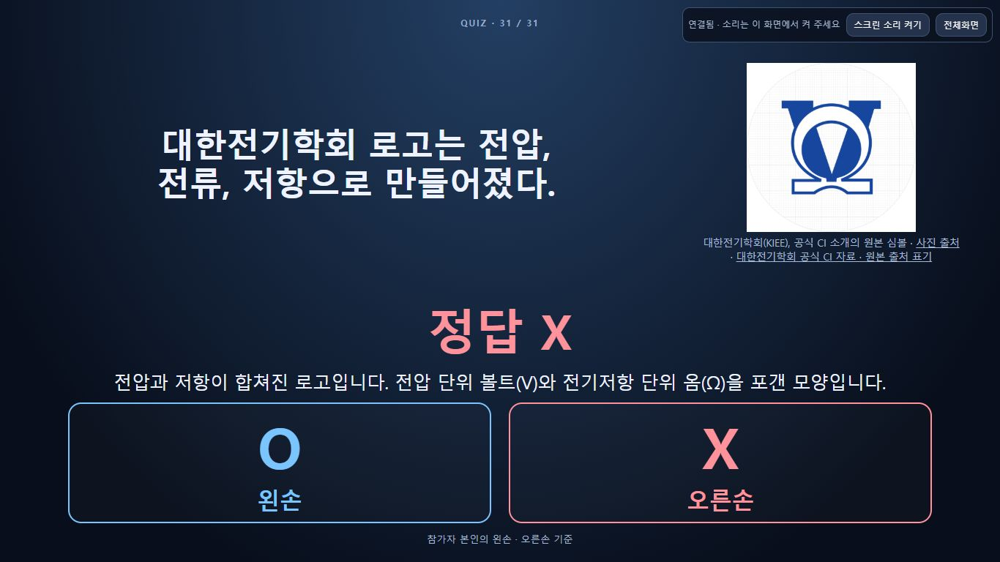
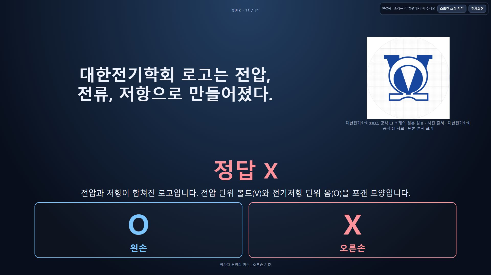

# 메인30·31번 로고 퀴즈 누적 추가 검증

기존29문항을 그대로 유지하고 사용자 요청 두 문항을 마지막에 누적 추가했다. 최종 본게임은 **31개**, 번외는33개다.

| 번호 | 문제 | 정답 |
|---|---|---|
|30|파이썬의 로고는 뱀 두 마리이다.|O|
|31|대한전기학회 로고는 전압, 전류, 저항으로 만들어졌다.|X|

31번 해설은 **“전압과 저항이 합쳐진 로고입니다. 전압 단위 볼트(V)와 전기저항 단위 옴(Ω)을 포갠 모양입니다.”**다. [대한전기학회 공식 CI 소개](https://www.kiee.or.kr/pages_introduce/ci.vm)에서 Ω와 V의 조합을 확인했다. 파이썬은 [PSF 공식 로고](https://www.python.org/community/logos/)와 [공식 FAQ](https://www.python.org/psf/trademarks-faq/)를 근거로 한다.

## 설계·구현 완료

[설계](../../design/manual-cloud.md)·[런북](../../planning/runbook.md)과 대시보드를 구현 전에 갱신했다. 새 작성 원본 `python-logo-2026-10-22.json`, `kiee-logo-2026-10-22.json`과 공식 PNG/출처 문서, 독립 offline/cloud seed 및 재생성 산출물만 변경했다. 모델·API·UI의 공개 인터페이스는 유지한다. 작성 원본은 빌드가 직접 읽지 않으며 각 seed에 최종 문항과 PNG를 내장했다.

공식 PNG는 변경하지 않았다. PSF269×326/20,637바이트, KIEE368×368/21,367바이트 원본을 각각 출처/권리 표기와 함께 넣었다. 두 문항은 `imageReveal: answer`이므로 정답 공개 전에는 사진과 해설이 공개 DTO에도 없다. 전체31개 중 사진 문제는11개, 정답 뒤 사진 문제는5개다.

## 저장·자료 보존 완료

실제 local4179/cloud의29개 문제집과 편집 필드를 먼저 백업했다. 파이썬30번 저장 후 후속 학회31번 요청을 받아 중간30개도 별도 백업하고 누적 추가했다. 미저장 사용자 편집은 없었다. 기존 JSON 가져오기/저장으로 양쪽31개 ACK를 확인했고, 로컬 새로고침과 최종 배포 재로그인 후에도31개가 유지됐다.

최종 두 UI 백업을 다시 내려받아 원래29개 전체 객체·순서·시간이 정확히 같고, 중간30개와도 전체prefix가 같으며 최종31개 전체가 의도한 은행과 일치함을 비교했다. 1번X·2번O·제주어23~28·전기국가29를 포함해 기존 내용은 유지된다. ignored `data/main-python-logo/`에 원본·중간·최종 은행과 비교 증거를 보관했다.

## 자동 검증·운영 반영 완료

- 수동91개+클라우드49개 **총140개 통과**, HTML/클라우드 빌드 모두31개. 데이터와 자산만 변경하여 JavaScript lint는 이번에 재실행하지 않았다.
- 실제 모델 전이로 두 문항 주제2초→자동5초, 정답 전 로고/해설 숨김, O/X 공개와 이미지 포함, 관리자 메모 비공개,30→31주제 및31→종료를 확인했다.
- 프로젝트 `gridex-companyinfo`, 리전 `asia-northeast3`. Build `2fcca05b-afba-4a4e-96db-ea4de996b0c7` SUCCESS, 완료 `2026-10-22T08:20:35.561923Z`.
- main Ready **`ox-manual-quiz-00011-rqp`**, `2026-10-22T08:21:15.206909Z`(17:21 KST), 트래픽100%. 이미지 `sha256:6a2af3aca4497ca44426f109b9ac53549e6697e7838a5d3722ac58db9e092b1f`.
- 제출 allowlist 패키지는53파일. 두 seed·두 원본 PNG·두 출처 문서의 SHA-256과 바이트가 현재 파일과 일치한다. PIN·키·명단·로컬 상태는 패키지에 포함하지 않는다. 공개 screen `00002-crf`는 유지했다. commit/push는 수행하지 않았다.
- 중간30개 `00010-7lv`는 후속 학회 문항 전 이력이며 최종31개로 대체했다.

## 실제 UI 검증 완료

CUA로 실제 HTTPS 진행실과 별도 공개 스크린을 조작했다. 로컬에서도31번 주제/자동 만료→수동X·공식 로고→종료→대문을 확인했다.

1. 최종 배포에 재로그인해31개 복원과30번 선택 ACK를 확인했다. 공개 후 컴퓨터 주제 예고→파이썬 문제와 자동 카운트다운(1초 관찰)으로 이어졌고 정답 전 이미지는0개였다.
2. 만료 뒤 직접 정답 공개 시 **O**와 PSF PNG의 실제 로드269×326을 확인했다. 다음 버튼이31번 **전기** 주제 예고로 이어졌다.
3.31번은 자동으로 문제/타이머 화면으로 전환했고 만료 뒤에도 정답을 기다렸다. 정답 전 이미지0개, 정답/해설 비공개였다. 직접 공개 후 **X**, 전압V·저항Ω 해설과368×368 공식 PNG 로드를 확인했다.
4. 노트북1366×768·프로젝션1920×1080의 실제 DOM 크기를 확인하고31번 문제/정답을 검토했다. 노트북 단계의 가로/세로 overflow가 없고 두 크기에서 글·로고·해설이 잘리지 않았다. 임시 화면 크기 설정을 원복했다.
5.31번 다음 버튼이 종료 화면으로 이어졌다. 양쪽 진행실을1번 대문으로 복원했고 최종 편집 상태는 ‘저장된 문제와 순서입니다.’다.

이 결과는 브라우저 화면 검증이며 실물 휴대폰·프로젝터·현장 음향/정밀 지연 계측과 구분한다. 전체31문항 리허설은 수행하지 않았다. 새로고침 전 첫 화면 크기 설정이 기존 탭에 즉시 반영되지 않아, 재로드 후 DOM1366/1920을 확인한 화면만 해당 크기 결과로 기록했다.

2026-10-22 17:26:49 KST의 별도 read-only 감사도 통과했다. 최신 GCS31개·기존29개 전체prefix·두 추가 객체와 원본PNG 일치, 수령28칸/revision9·음향/키·두 서비스 접근/최소1대/상시CPU·자정 예약/워크플로 불변을 확인했다. 감사의 공개 DTO 검사는 fresh snapshot 기반 순수 함수 검사이며 위 실제 UI 확인과 구분한다. [검증 JSON](main-python-logo.json)에 근거를 기록했다. 자정 실제 OFF 실행 완료는 이후 별도 확인 범위다.
