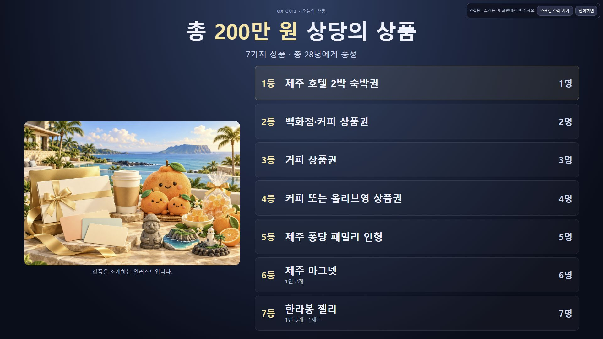

# 실제 클라우드 배포 및 오늘 운영

> 후속 요청으로 프로젝션만 Google 로그인 없이 열리는 별도 서비스를 추가했다. 새 공개 주소·최신 두 revision·139개 검사·두 서비스 자정 예약은 [프로젝션 공개 검증](public-screen.md)을 우선한다. 아래는 최초 IAP 배포 시점의 기록이다.

이 기록은 앞선 [로컬 검증](manual-cloud.md)의 후속 운영 결과다. 실제 서비스는 CompanyInfo 프로젝트 `gridex-companyinfo`(953995790322), 서울 `asia-northeast3`의 **ox-manual-quiz**다.

- [진행실](https://ox-manual-quiz-953995790322.asia-northeast3.run.app/presenter): `khj@gridex.biz` Google/IAP 로그인 후 앱 PIN으로 접속한다. PIN은 Git 무시 대상 `data/cloud-deployment/접속안내.txt`에만 기록했다.
- Cloud Build `0b43158c-857c-46f9-8f06-4babfd2eab9c` **SUCCESS**, 실제 Cloud Run **Ready**. 준비 revision `ox-manual-quiz-00002-jng`.
- 이미지 digest: `sha256:85a740c1c23c8bc6431d1222f00cbac97e5fab65f67f7807476575542ab83dcd`.
- 현재 서비스 최소1대·리비전 최소1대·최대1대, CPU 상시 할당, IAP 활성화를 실제 재조회했다.
- 인증된 브라우저에서 숫자 호스트의 `/api/health`가 `{"ok":true,"mode":"manual","persistence":"gcs"}`를 반환했다. 익명 접근 성공을 뜻하지 않는다.

## 모듈 및 배포 경계

진행실/스크린은 공통 수동 모델·presentation을 사용하고, cloud transport가 인증·revision·명령 전달을 담당한다. 서버의 manual service가 게임/문제/명단 저장을 직렬화하고, GCS store가 generation 조건으로 영속 저장한다. 기존 참가자 게임과4179 오프라인 서버는 보존했다. 전체 설계와 공개 인터페이스는 [설계](../../design/manual-cloud.md), 배포 절차는 [배포 런북](../../planning/manual-cloud-deploy.md)에 있다.

전용 runtime/build/예약 계정·private GCS·Secret Manager·Artifact Registry를 사용했다. 조직의 Domain Restricted Sharing으로 공개 allUsers 바인딩이 거절되어 Cloud Run 기본 IAP와 Google 로그인을 적용했다. 조직 정책을 해제하거나 invoker 검사를 우회하지 않았다.

## 실제 HTTPS 화면 검증

CUA로 실제 Cloud Run 진행실과 별도 스크린을 조작했다. 브라우저 반응형·해상도 검증이며 실제 휴대폰 LTE, 행사 프로젝터 및 스피커의 검증은 남아 있다.

| 항목 | 실제 결과 |
|---|---|
| 로그인·연결 | Google/IAP 및 앱 PIN 로그인 성공. 별도 키로 연결한 스크린에서 같은 게임 상태 표시 |
| 시작 인사·상품 소개 | 대문 → 상품 소개 → 첫 문제 전환. 상품7등급·28명·총200만원 및 상품 이미지 유지 |
| 노트북·프로젝션 | 1366×768과1920×1080 상품 소개 캡처. 첫 문제의 자동 카운트다운 및 수동 정답 공개 확인 |
| 모바일 너비 | 실제 캡처375×812에서 진행실 반응형 배치와 시작 버튼 확인. 전체 페이지는 세로 스크롤 사용 |
| 직접 제어 | 원격 정답 공개 후 스크린 반영을 한 번 측정한 값591ms. 전체 망·휴대폰 성능 보장은 아님 |
| 노래·런북 | Q2 노래 문제의 시간 표시 없음, 번외 퀴즈 진입 후 본게임 Q2로 복귀 확인 |
| 문구·정답·순서 저장 | Q3의 임시 문구/정답 및Q3·Q4 교환 저장 → 드롭다운 갱신 → 새 탭 유지 확인. 원래 문구·정답·순서로 복구 |
| 수령 기록 | 합성 이름을 저장하고 새로고침 후 복원 확인. 전화번호 DOM 값은 도구의 개인정보 마스킹으로 동일성 판정 불가. 시험 입력 후 두 필드를 비우고 서버 저장 ACK 확인 |
| 마지막 상태 | 첫 문제 전 대문, 본게임 첫 순서, 스크린 음향 꺼짐. 행사에서는 스크린의 소리 켜기를 한 번 누르고 진행실에서 음향을 켠다 |

최종 fresh GCS 읽기에서 **20문항 전체 객체가 사용자 cloud seed와 일치**했다. 수령자28개는 **이름·전화번호 모두 빈 값**이다. 기존 CompanyInfo 서비스10개는 이름·리전·준비 revision·트래픽 모두 동일하며 추가/누락이 없다(신규 퀴즈1개 제외). 기본 gcloud 설정도 유지했다.

## 자정 상시 가동 해제 예약

사용자가 지정한 **2026-10-23 00:00 KST = 2026-10-22T15:00:00Z**에 한 번 실행하도록 GCP Cloud Tasks를 등록하고 다시 조회했다. PC가 꺼져 있어도 GCP에서 실행한다.

| 단계 | 확인 상태 |
|---|---|
| Cloud Tasks | queue `ox-manual-ops`, task `a0c16796318f5067-20261023-night-stop`. scheduleTime·고정 서비스·expectedStop·실제 body의 dryRun=false 확인 |
| Workflows | `ox-manual-night-stop`, ACTIVE, revision `000003-6d8`. 실제 제공자 컴파일 통과 |
| 인증 체인 시험 | 즉시 시험 Task → OAuth task 계정 → Workflows → stop 계정 → Run GET 및 validateOnly PATCH 접수 성공. 실행 `60f86a61-4bb8-47f7-b348-60f0e5ea5d57` SUCCEEDED |
| 사전 검증 한계 | 결과는 **DRY_RUN_ACCEPTED**, validationAccepted=true, validationCompleted=false, patchValidated=false. validateOnly의 미완료 operation은 GET404를 반환했으므로 완료로 간주하지 않음 |
| 실제 자정 변경 | 미래 실행 대기. 서비스/리비전 최소0대·cpuIdle=true로 바꾸고, 서비스 GET으로 목표값·reconciling=false·terminal success·generation 일치까지 확인하도록 구현 |
| 보조 확인 | Codex 단발 예약 `ox-off`, 10/23 00:02. 기본 실행은 GCP Task이며, 보조 예약은 앱/PC가 실행될 수 있는 환경에 의존 |

OFF는 **상시 가동 해제**다. URL과 문제·명단은 보존하며, 요청이 없으면 자동0대로 줄어든다. 계속 열린 진행실/스크린은 상태 확인 요청을 보내므로 행사 후 해당 창을 닫는다. 서비스 삭제나 접속 차단을 예약한 것은 아니다.

stop 계정은 이 퀴즈 서비스의 get/update, runtime 계정 actAs, 퀴즈 Artifact Registry reader만 갖는다. task 계정의 실행 생성 권한은 프로젝트 범위이나00:30KST에 만료되는 조건이 있다. workflow의 고정 대상/시각 가드와 Task 고정 URL을 별도로 검사한다. 시도했던 project 범위 Run operation 조회 권한은 불필요해 회수했다.

## 검사 및 남은 범위

- 최종 앱 소스: 수동 회귀90/90·클라우드40/40·린트·클라우드/오프라인 빌드 통과. 테스트는 실제 클라우드 UI/GCS 검증과 별도 근거다.
- 단독 HTML과4179 사용자 저장 문제를 유지했다. GitHub commit/push는 수행하지 않았다.
- 실제 자정 변경 결과, 실기 휴대폰·현장 스피커/프로젝터 리허설은 아직 확인되지 않았다.
- 안전한 영수증·자료 보존 검사: Git 무시 대상 `data/cloud-deployment/{service-live-receipt,night-stop-task-receipt,night-stop-dry-run,final-preservation-check}.json`.

## 화면 근거

- [노트북 상품 소개1366×768](cloud-live-prizes-1366.jpg)
- [첫 문제1366×768](cloud-live-first-question-1366.jpg)
- [정답 공개1366×768](cloud-live-first-answer-1366.jpg)
- [모바일 너비 진행실375×812](cloud-live-host-375.jpg)
