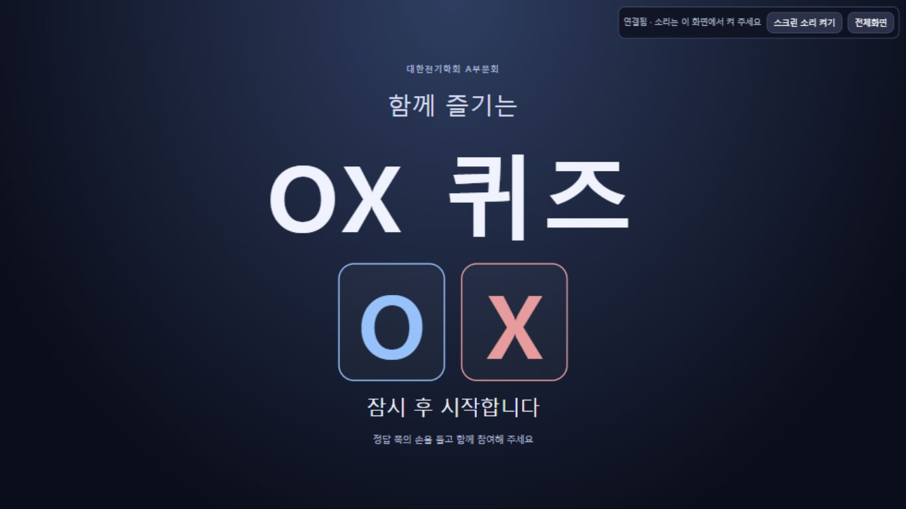

# 프로젝션 로그인 없이 접속

> 대문에 게임 방법과 **시간이 끝나면 손들기** 안내를 추가한 최신 화면/리비전은 [대문 안내 검증](cover-guide.md)을 우선한다. 공개 주소·인증 분리와 자정 예약은 유지했다.

사용자 요청에 따라 프로젝션 전용 [공개 화면](https://ox-manual-screen-953995790322.asia-northeast3.run.app/screen)을 배포했다. 실제 연결은 진행실에서 제공하는 **키 포함 링크**를 사용하며 Google 로그인이나 진행자 PIN이 필요 없다. 긴 연결 키는 문서·Git에 기록하지 않는다. 기존 [진행실](https://ox-manual-quiz-953995790322.asia-northeast3.run.app/presenter)은 Google/IAP와 PIN을 유지한다.

## 구현과 권한 경계

- `cloud/screen-server.mjs`: 화면 정적 파일과 GET `/api/screen/state`만 제공하는 읽기 전용 서버. 긴 키를 검사하고 기존 비공개 퀴즈 서버의 공개 DTO만 읽는다. 관리자·명단·전체 문제·쓰기 경로를 중계하지 않는다.
- IAP 서버 간 인증: `ox-manual-screen` 전용 계정이 자기 JWT를 IAM Credentials로 서명한다. audience는 기존 `/api/screen/state` URL 하나, 유효20분·만료1분 전 갱신·동시 발급1건이다. metadata/IAM/upstream fetch에 각7초 제한을 두고 리디렉션과 사용자 쿠키/인증 헤더 전달을 막는다.
- 공개 실행 계정은 자기 signJwt 단일권한, 기존 퀴즈 IAP 접근, 스크린 키 비밀1개 조회만 가진다. GCS·관리자 PIN·Run 수정 권한과 서비스 계정 키 파일이 없다.
- `cloud/server.mjs`: `PUBLIC_SCREEN_URL`이 있으면 관리자 응답의 스크린 링크만 새 origin으로 만든다. 게임 모델·문제·명단 저장·진행실 인증은 유지한다.
- `cloud/Dockerfile`: `screen` target에는 공개 HTML/JS/상품 이미지 JSON과 화면 서버만 복사한다. 관리자 HTML·seed·GCS SDK는 포함하지 않는다. 기본 target은 기존 presenter다.
- 선행 [모듈 설계](../../design/manual-cloud.md)와 [배포 절차](../../planning/manual-cloud-deploy.md)를 유지한다. 이후 main 재배포에서도 `-PublicScreenUrl`을 명시하거나 기존 환경변수 값을 보존한다.

실제 조직 정책 조회에서 managed invoker-required=false를 확인했고 기존 DRS 회사 고객1개 제한은 유지했다. 새 화면 서비스에만 `--no-invoker-iam-check`를 적용했다. 기존 진행실 IAP나 회사 조직 정책을 완화하지 않았다. 이는 [공식 Cloud Run 공개 방식](https://docs.cloud.google.com/run/docs/authenticating/public)이며 서버 간 인증은 [공식 IAP 서비스 계정 JWT](https://docs.cloud.google.com/iap/docs/authentication-howto#authenticate_with_a_service_account_jwt)를 따른다.

## 배포와 자동 검사

| 항목 | 실제 결과 |
|---|---|
| Cloud Build | `30528751-2e60-402f-b641-653baf691e84` SUCCESS. 같은 허용 목록49파일에서 두 target 빌드 |
| 진행실 | `ox-manual-quiz-00003-dd5`, Ready·100% 트래픽, IAP 유지 |
| 공개 스크린 | `ox-manual-screen-00001-dtz`, Ready·100% 트래픽, Google 로그인 없음 |
| 검사 | 클라우드49/49 통과(새9개 포함), 전체 ESLint·cloud build·diff 검사 통과. 수동90개는 직전 통과 결과가 유효하며 이번 변경으로 재실행하지 않음 |
| 소스 일치 | 배포 패키지의 server/screen-server/Dockerfile/screen.js/20문항 seed가 작업 소스의 SHA-256과 일치 |
| 현재 가동 | 두 서비스 모두 서비스/리비전 최소1대·최대1대·CPU 상시 할당. 공개 서비스 메모리는 제공자 제한에 따라512Mi |

이미지 digest는 진행실 `sha256:515930f20ba7af6c9466a5f58838fc6946fc807fdc66c47242ef0157997cb217`, 스크린 `sha256:71edd36cee50cc7e38e7d1a5200f383058b6be38babaab13cf2fe5f7a1955b0c`다.

## 쿠키 없는 실제 HTTPS 검증

Node fetch의 Google 인증 헤더·쿠키 없는 요청으로 검사했다. 스크린 API 호출에만 스크린 키를 헤더로 넣었다. 브라우저의 기존 Google 로그인 세션에 기대어 무로그인을 판정하지 않았다.

| 요청 | 결과 |
|---|---|
| 공개 `/screen`, `/screen.js` | 200, 로그인 리디렉션·Set-Cookie 없음 |
| 키 포함 `/api/screen/state` | 200. 최상위 revision/serverNow/view/audio만 반환, 실제 native IAP JWT 중계 성공 |
| 키 없는 스크린 API | 401 |
| 공개 `/presenter`, `/api/admin/recipients` | 404 |
| 기존 비공개 진행실 | 302 Google/IAP 리디렉션 유지 |

실제 CUA로 새 공개 스크린을 열고, 보호된 진행실에서 상품 소개→워밍업→첫 문제→수동 정답 공개→다음→대문을 조작했다. 진행실이 제공하는 링크가 새 public origin인 것도 확인했다. 화면은 본게임 첫 순서·대문·음향 꺼짐으로 복귀했다. 노트북1366×768 캡처이며 실제 행사 휴대폰/스피커/프로젝터 검증은 별도다.

## 자정 예약 보존 및 확장

기존 일회성 Task `a0c16796318f5067-20261023-night-stop`와 예약 시각 **2026-10-23 00:00 KST(10/22T15:00Z)**는 유지했다. workflow `ox-manual-night-stop`을 ACTIVE revision `000004-58d`로 실제 배포하여 고정된 **진행실·공개 스크린 두 서비스**의 min0/요청 CPU 전환을 수행한다. 한쪽이 실패해도 다른 쪽을 시도하고 마지막에 전체 실패 여부를 보고한다. IAP/공개 여부·화면 키·문제/명단·컨테이너 환경을 유지한다.

실제 Cloud Task→OAuth→workflow→각 서비스 GET/validateOnly PATCH 시험 execution `30bf3bb7-9ecc-4030-9dcb-46e9dea7e579`은 SUCCEEDED이며 양쪽 모두 **DRY_RUN_ACCEPTED**다. validationCompleted=false·patchValidated=false이므로 사전 변경 검증의 최종 완료를 뜻하지 않는다. 실제 자정 적용 결과는 미래의 확인 사항이다. 보조 Codex 예약 `ox-off`(00:02)도 두 고정 서비스 확인으로 갱신했다.

## 증거

최종 read-only 검사에서 기존 CompanyInfo 서비스10개의 이름·리전·준비 revision·트래픽과 저장된 gcloud 기본 설정이 모두 유지됐다. 새 퀴즈 두 서비스만 제외하면 추가/누락/변경은0개다. fresh GCS의20문항 전체 객체가 원래 사용자 seed와 일치하고, 수령자28칸의 이름·전화번호는 모두 빈 값이다. 안전 결과는 `public-screen-preservation.json`·`public-screen-services.json`에 기록했다.

안전한 API·빌드·정책·예약 영수증은 Git 무시 대상 `data/cloud-deployment/public-screen-{anonymous,build,policy,night-stop-dry-run,task-receipt}.json`이다. PIN과 키가 포함된 개인 접속 안내는 같은 폴더의 `접속안내.txt`에만 갱신했다. Git commit/push나 기존4179 변경은 수행하지 않았다.

- [공개 스크린 상품 소개](public-screen-prizes-1366.jpg)
- [공개 스크린 첫 정답](public-screen-first-answer-1366.jpg)
