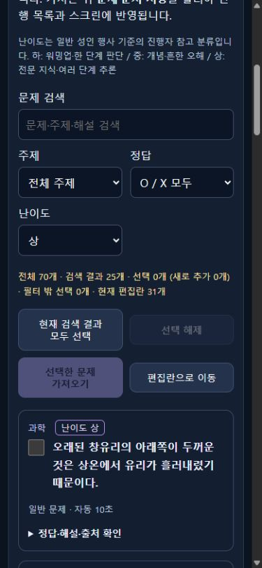

# 난이도별 문제은행

## 변경 범위

초기70개에서 지나치게 쉬운 단위 암기·반복되는 행성 순서·명백한 오답52개를 제거하고 새 ID52개로 교체했다. 유지18개의 ID·지문·정답은 동일하다. 과학·자연·우주·지리·역사·문학/언어·수학·스포츠·예술/문화·기술 등10개 주제를 포함한다. 전기 전용 문항은 없다. [문항별 출처와 ID 변경 내역](../../research/question-catalog-sources.md).

| 분류 | 하 | 중 | 상 | 합계 |
|---|---:|---:|---:|---:|
| 후보 수 | 10 | 35 | 25 | 70 |

정답은 O35/X35다. 난이도는 일반 성인 행사 기준의 편집 판단이며 참가자 배경에 따른 체감 난이도를 보장하지 않는다. 하=워밍업·한 단계 판단, 중=개념·흔한 오해, 상=전문 지식·여러 단계 추론으로 분류했다.

- 문제은행 카드에 난이도를 표시하고 `전체 난이도/하/중/상` 필터를 추가했다. 검색·주제·정답·난이도를 AND로 적용한다.
- 필터 밖 체크도 유지하며 숨겨진 선택 수를 표시한다. 현재 검색 결과 모두 선택은 현재 조합에 맞는 후보에만 적용한다.
- 가져온 난이도는 편집란에서 수정하거나 미분류로 해제한다. 공통 모델·서버 저장·초안 복원·JSON·선택적 CSV 난이도 열에서 유지한다. 이전 문제에 난이도가 없어도 그대로 허용한다.
- 기본 메인31·번외33 JSON은 변경하지 않았다. 기존에 가져온 후보·현재 확정 문제집·미완성 초안을 자동 삭제하거나 교체하지 않는다. 공개 스크린에 난이도나 전체 후보를 추가하지 않는다.

## 자동 검증

`npm test` **194/194 통과**, `npm run lint`, `npm run build` 통과. 기존 문제은행185개 검증에 난이도 조합·선택 유지·잘못된 분류 거부·저장/초안 복원·CSV/JSON·편집 미분류 처리·실제 서비스 파일 저장/재시작·공개 DTO 경계9개를 추가했다. 실제 후보70개·모든 난이도·정답 균형·고유 ID/문구·기존31/33과 중복 없음도 검사했다.

변경 문서의 상대 링크54개에 누락이 없고 실제 개발 PIN·스크린 키도 포함하지 않았다. 기본/번외 JSON의 Git 객체 해시는 기준 커밋과 같았다.

## 실제 브라우저 검증

컴퓨터 유즈로 별도 로컬 검증 서버4192에서 다음을 확인했다. 실제 운영 Cloud를 대상으로 한 검증이 아니다.

1. 상 필터에서25개가 나왔다. 상 문항1개를 체크한 뒤 기술·O 정답·GPS 검색으로 좁히면1개가 나왔으며 앞선 체크1개는 필터 밖 선택으로 유지됐다.
2. 두 번째 문항도 체크하고 난이도를 중으로 바꾸자 검색 결과0개·선택2개·필터 밖 선택2개가 표시됐다.
3. 가져온2개는 기존31개 뒤에 추가됐다. 편집란에서 두 문항의 난이도가 모두 상인 것을 확인하고32번을 중으로 바꾼 뒤 저장했다.
4. 저장 ACK 후33개 문제 선택 목록을 확인했고, 새로고침 후32/33번의 중/상 분류가 복원됐다. 기존31개는 미분류였다.
5. 검증 목록을 기본31개로 복원한 뒤 임시 서버와 탭을 종료했다.

4190 개발 서버는 기존 상태 파일을 백업한 뒤 새 공통 모델을 적용하기 위해 재시작했다. 재시작 전후 저장 JSON 전체의 의미상 동일함을 비교했다. 기존 문제집·행사/상품 설정·명단·키를 변경하지 않았다. 최종4190 화면에서 하10·중35·상25 결과를 확인하고,1366×900/390×844에서 콘텐츠 폭1351/375px와 문서 폭이 같아 가로 넘침이 없음을 확인했다. 가상 화면 크기 검증은 실물 휴대폰·현장 프로젝터 리허설과 구분한다.

## 반영 범위

구현·로컬 자동/브라우저 검증을 완료했고 소스·매뉴얼·검증 자료를 Git 발행 대상으로 확정했다. 사용자 지시에 따라 Cloud Run 배포·운영 인증 변경은 하지 않았다.
