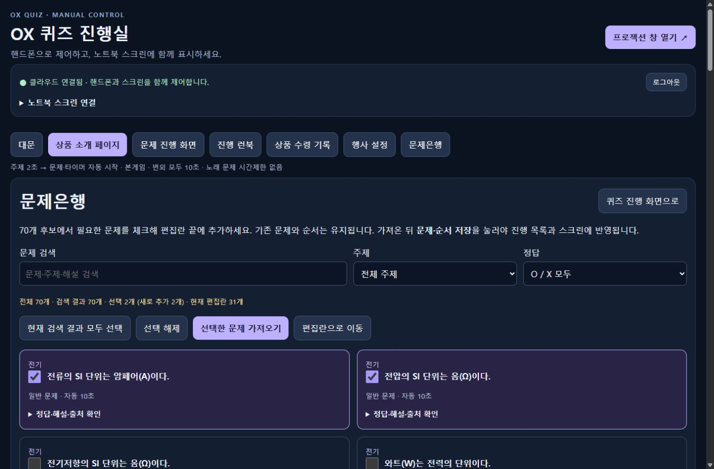
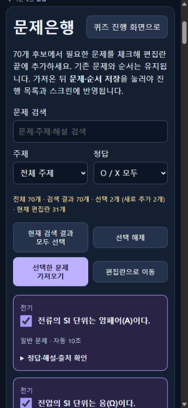

# 체크박스로 가져오는 문제은행

## 구현

진행실 상단의 **문제은행** 탭, **행사 설정 → 문제은행에서 문제 선택하기**, 문제 편집 영역의 **문제은행에서 선택**을 같은 목록으로 연결했다. 후보는 `questions/catalog.json`에 별도로 저장하며 기존 메인31문항과 번외33개는 변경하지 않았다.

- 10개 주제별7개, 총70개. O35/X35, 자동10초, 해설과 출처를 포함한다. [후보 작성 근거](../../research/question-catalog-sources.md).
- 검색·주제·정답 필터, 현재 검색 결과 모두 선택, 선택 해제, 개별 체크박스를 제공한다. 필터와 탭을 바꿔도 체크 상태를 유지한다.
- 선택한 후보만 편집란 끝에 후보 목록 순서대로 추가한다. 미완성 문구·보기·정답·사진·메모·순서를 가진 기존 초안을 검증으로 제거하거나 교체하지 않는다.
- NFKC·공백·대소문자를 정규화한 같은 지문은 중복 추가하지 않는다. 이미 편집란에 있는 후보는 체크박스를 비활성화한다. 추가 후 전체300문항 상한을 초과하면 추가 전 중단한다.
- 가져오기는 로컬 초안 보관 단계다. 진행 목록·문제 선택 드롭다운·스크린은 기존 **문제·순서 저장**의 서버 ACK 이후 갱신한다. 저장 실패나 저장 중 추가 편집은 기존 복원/충돌 처리에 맡긴다.
- 후보 전체·해설은 진행실 번들에만 포함한다. 읽기 전용 스크린의 번들·공개 DTO에는 전체 문제은행을 추가하지 않는다. 새 서버 API나 인증 변경은 없다.

## 자동 검증

`npm test` **185/185 통과**, `npm run lint`, `npm run build`, `git diff --check` 통과.

변경 문서의 상대 링크50개는 모두 존재했다. 기존 기본/번외 JSON 두 파일은 Git 객체 해시가 기준 커밋과 동일했고, 변경 문서에 실제 개발 PIN·스크린 키가 포함되지 않았음을 확인했다.

문제은행 모듈14개와 진행실 연결7개 검사를 추가했다. 실제 후보70개의 주제별 개수·정답 균형·ID/문구 중복·기존31/33과의 중복·10초·출처 조건을 검사한다. 단위/합성 UI 검증은 선택 유지·검색·중복·300개·HTML escape·HTTPS 출처와 가져오기 실패·연속 입력을 포함한다. 진행실 합성 검증은 미완성 초안 보존, 명시적 ACK 후 목록 갱신, 실패 후 복원, ACK 대기 중 추가 편집, quota 오류와 공개 스크린 번들 분리를 확인한다.

## 실제 브라우저 검증

컴퓨터 유즈로 로컬 격리 서버 `127.0.0.1:4192`의 별도 파일 저장소에서 확인했다. 원래4190 개발 상태와 운영 Cloud 저장소는 변경하지 않았다.

1. 기존 첫 문제를 편집한 뒤 행사 설정에서 문제은행으로 이동했다. 기존 확정31개는 유지됐다.
2. 전기 후보1개를 체크하고 수학 필터로 바꿔1개를 추가 체크했다. 검색 결과가0개가 되어도 선택2개가 유지됐다.
3. 가져오기 후 편집 초안33개·확정 드롭다운31개였고, 첫 문제의 미저장 편집도 유지됐다.
4. **문제·순서 저장** 후 성공 메시지와 드롭다운33개를 확인했다. 추가된 두 문제는32·33번이었다. 새로고침 후에도33개와 편집 문구가 복원됐다.
5. 다시 문제은행을 열어 가져온 문제의 체크박스가 비활성화되고 `편집란에 있음`이 표시되는 것을 확인했다. 정답·해설·출처 펼치기도 확인했다.
6. 격리 검증 목록은 기본31개로 복원하고 검증 서버를 종료했다. 기존4190에서는 후보 선택 표시만 확인하고 해제했다. 가져오기·문제집 저장은 실행하지 않았다.

최종4190 화면을1366×900과390×844에서 확인했다. 실제 콘텐츠 폭1351/375px에서 문서 폭이 각각 같아 가로 넘침이 없었다. 체크박스와 문구는 같은 행에 배치되고 휴대폰의 버튼 문구는 단어 단위로 줄바꿈한다. 화면 크기 재현은 물리 휴대폰·프로젝터 실기 검증과 구분한다.

## 반영 범위

구현·로컬 자동/브라우저 검증 완료. 소스·사용 매뉴얼·스크린샷은 Git 발행 대상이다. 사용자의 기존 지시에 따라 Cloud Run 배포·운영 인증 갱신은 진행하지 않았다. 운영 서비스에는 별도 배포 전까지 이 기능이 반영되지 않는다.
