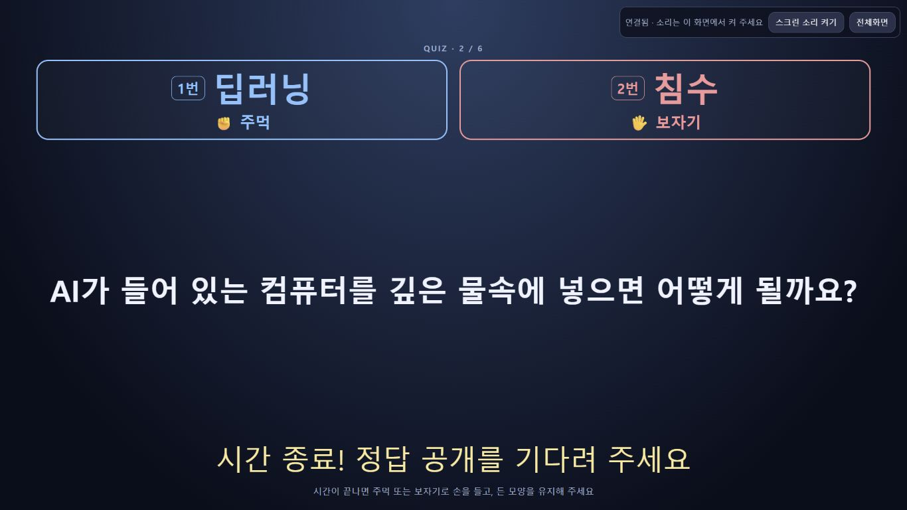
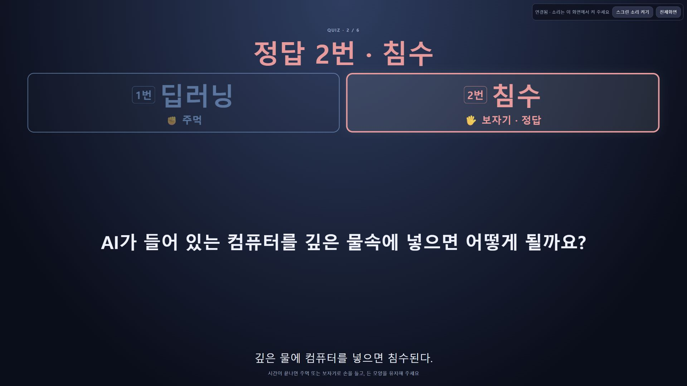
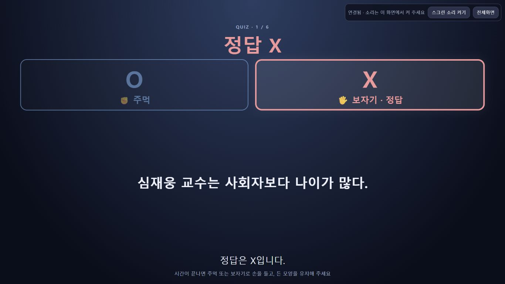
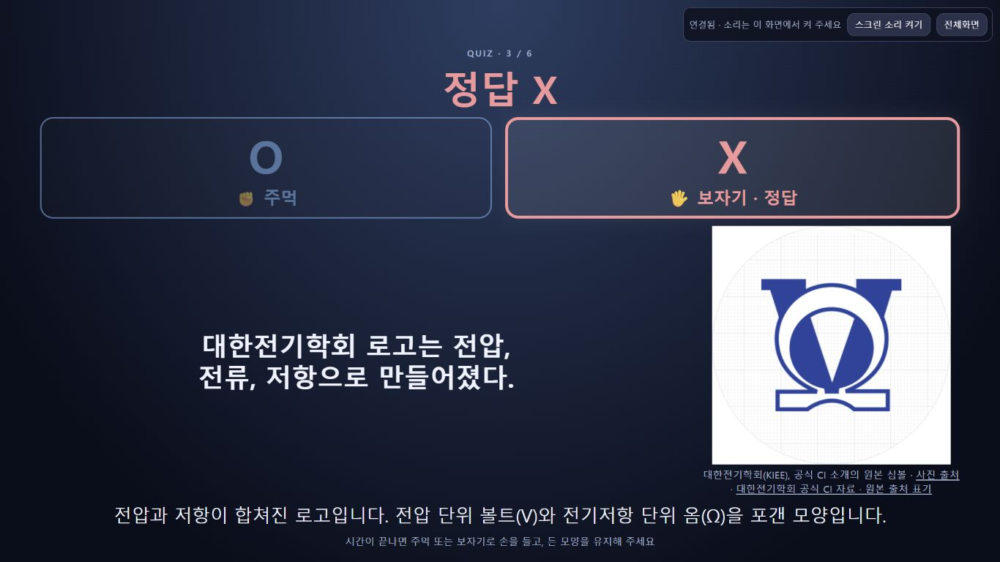

# 보기와 정답 상단 배치

## 구현

공통 `renderQuizStage`에서 문제 단계부터 `.quiz-top`에 O/X 또는1번/2번 보기를 표시한다. 정답 공개 후에는 같은 영역에 정답 문구와 맞는 보기의 테두리·정답 표시를 추가한다. 문제·사진은 그 아래, 타이머 또는 해설은 하단에 둔다. 진행실 미리보기와 스크린이 같은 마크업/CSS를 사용한다.

O/X 보기는 O/X로 표시하고, 다른 선택지는 **1번=첫 번째 보기(O)·주먹**, **2번=두 번째 보기(X)·보자기**로 표시한다. 화면 좌우 배치를 바꿔도 이 매핑을 유지한다. 주관식에는 O/X·1/2 보기를 만들지 않으며 공개 후 실제 정답만 상단에 표시한다.

공개 DTO·문제 데이터·타이머·저장 API는 변경하지 않았다. 정답 공개 전에는 정답 강조·해설·정답 단계 전용 사진을 표시하지 않는다. 스크린 상단 도구 모음 아래에 여백을 확보하고, 사진이 남은 본문 영역 안에서 맞춰지도록 했다.

## 자동 검증

전체 **202/202**, `npm run lint`, `npm run build` 통과. 새8개 검사는 문제/정답의 상단 순서, 공개 전 답·해설·사진 숨김, OX/번호형·좌우 교체·주관식·긴 문자 escape를 확인한다. 기존 손 모양 검사는 새 마크업에서 같은 보기와 제스처 연결을 검사하도록 갱신했다.

변경 문서의 상대 링크61개에 누락이 없고 실제 개발 PIN·스크린 키도 포함되지 않았다. 기본31·번외33·후보70 JSON의 Git 객체 해시와 기존4190 저장 JSON은 작업 전과 동일했다.

## 브라우저 검증

컴퓨터 유즈로 별도4192 로컬 서버의6개 검증 문항을 제어했다. 실제 기본 문항에서 OX·선택형·정답 후 로고 사진을 복사하고, 긴 보기와 주관식은 검증용 문항으로 준비했다. 이 자료는 ignored `data/answer-top-validation`에만 두었으며 현재 행사 문제집에 추가하지 않았다.

- **1366×768**: O/X 문제와 공개 정답, 번호형 문제, 정답 후 사진, 긴 두 보기/해설, 주관식을 확인했다. 문서 폭/높이가 viewport와 같고 보기 영역 하단보다 문제 영역 상단이 아래였다.
- **1920×1080**: 번호형 정답 화면에서 `정답 2번 · 침수`와 두 보기가 상단에 표시되고 문제·해설이 아래에 유지됐다.
- 일반 OX 보기 글자 크기는1366 화면에서 약61px였다. 도구 모음은 y10~57px, 보기 영역은 y90px 이후여서 겹치지 않았다.
- 사진 문항은 공개 전 이미지0개, 정답 공개 후 이미지 로딩 완료를 확인했다. 상단 영역 y90~299px, 본문 y309~678px, 사진 y309~634px, 해설 y688~721px로 분리됐다.
- 긴 보기 정답 화면은 상단 영역 y90~513px, 본문 y523~678px, 해설 y688~721px였다. 세로/가로 넘침이나 겹침이 없었다.
- 주관식 문제 단계의 보기/정답은 각각0개였고, 공개 후 `정답 즐겁게 참여하는 마음`이 상단에 나타났다. 진행실 미리보기에서도 보기 하단이 문제 상단보다 위였다.

검증 중 상단 폭이 절반으로 줄고 보기 글꼴이 축소되는 CSS 상속 문제를 발견해 전체 폭 grid 열과 보기 글꼴 우선순위를 수정한 뒤 위 화면을 다시 확인했다. 실제 프로젝터·관람 거리에서의 가독성 리허설과는 구분한다.

[긴 보기](long-options-answer-1366.jpg) · [주관식](open-answer-1366.jpg) · [OX 문제](ox-question-1366.jpg)

## 반영 범위

원래4190 개발 서버가 꺼져 있어 기존 접근 정보·저장 파일을 보존한 채 시작했다. 해당 서버의 문제집·행사 설정·상품·명단·진행 위치를 변경하지 않았으며 저장 JSON을 작업 전 백업과 비교했다. 원래 스크린에는 기존 상품 소개 상태를 유지하며 새 빌드를 연결했다. 검증용4192 서버·탭은 종료했다.

구현·자동/브라우저 검증 완료. 문서·소스를 함께 Git 발행 대상으로 확정했으며 Cloud Run 배포는 하지 않았다.
