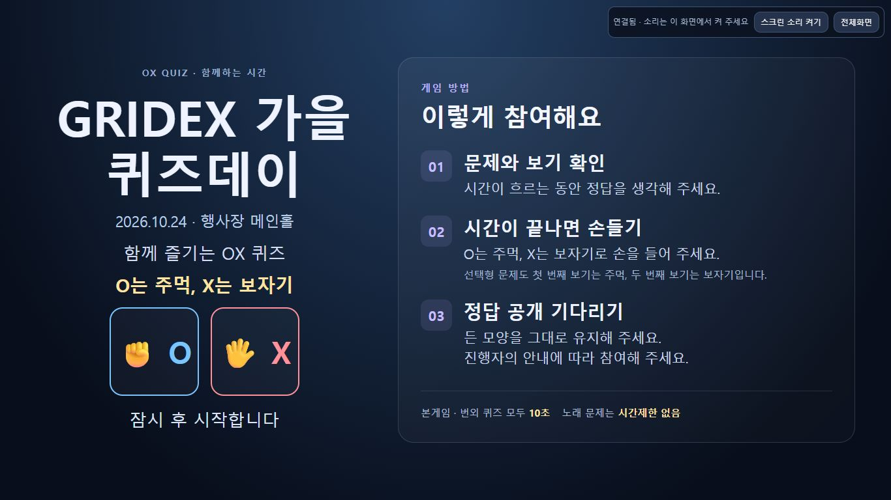
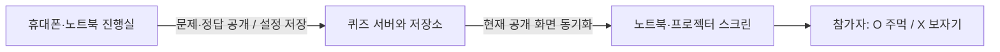
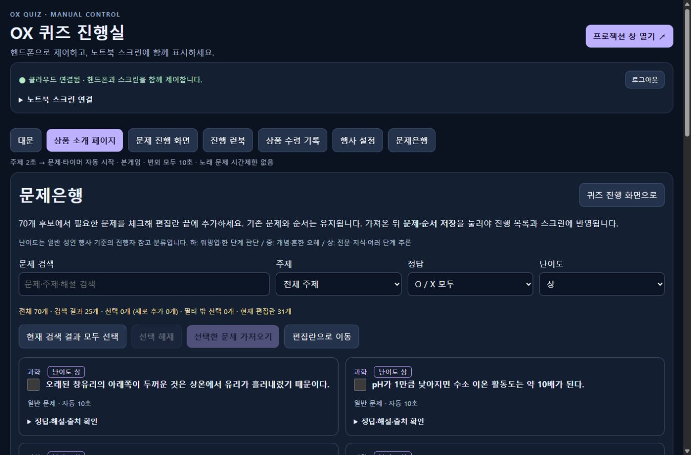

# OX Quiz Cloud

> 소속: [Gridex-Ent](https://github.com/Gridex-Ent) · 저장소: [Gridex-Ent/quiz-ox](https://github.com/Gridex-Ent/quiz-ox) · 공개


**행사마다 이름·날짜·상품 이미지를 바꾸어 사용하는, 진행자 중심의 OX 퀴즈입니다.**

진행자는 휴대폰이나 노트북의 **진행실**에서 문제를 공개하고, 참가자는 **프로젝션 화면**을 보며 답합니다. 시간이 끝나면 **O는 주먹, X는 보자기**로 손을 듭니다. 정답과 다음 문제를 공개하는 속도는 진행자가 직접 조절합니다.

[빠른 시작](#빠른-시작) · [사용 매뉴얼](#사용-매뉴얼) · [상세 사용자 가이드](DOCS/USER_GUIDE.md) · [개발 구조](#개발-구조) · [검증 기록](DOCS/validation/2026-10-24/cloud-events.md)



*화면 예시입니다. 행사명·날짜·장소·안내 문구는 진행실에서 바꿀 수 있습니다.*

## 어떤 프로젝트인가요?

워크숍, 세미나, 송년회 등에서 진행자가 참가자와 함께 운영하는 **클라우드 전용 행사 퀴즈**입니다. 행사 정보, 문제집, 진행 상태, 상품 이미지와 수령 기록을 서버에 저장합니다. 진행실에서 조작하면 연결된 스크린들이 같은 상태를 표시합니다.



| 기능 | 내용 |
|---|---|
| 행사별 설정 | 행사명·날짜·장소·안내 문구를 저장해 대문과 종료 화면에 표시 |
| 상품 소개 | PNG·JPEG·WebP·GIF **4 MiB 이하** 업로드, 미리보기·설명·캡션·기본 이미지 복원 |
| 문제 준비 | 문제·보기·정답·해설·주제 편집, 순서 이동, CSV/JSON 가져오기와 JSON 백업 |
| 문제은행 | 여러 분야의 OX 후보70개, 상·중·하 난이도 표시와 검색·주제·정답·난이도 조합 필터, 체크 선택·중복 방지 |
| 직접 진행 | 주제 **2초** → 문제·타이머 자동 시작 → 진행자가 정답 공개 → 다음 문제 |
| 시간 규칙 | **일반·번외 모두 10초**, 노래 문제는 시간 표시 없이 진행 |
| 참여 방법 | 시간이 끝나면 **O=주먹, X=보자기**. 선택형도 첫 번째 보기=주먹·두 번째 보기=보자기 |
| 진행 런북 | 준비된 번외 선택·본게임 문제 복사·즉석 출제 후 본게임으로 복귀 |
| 음향 | 배경음악, 문제/정답 공개·종료 효과음, 매초 똑딱 소리, 공식 YouTube 문항 |
| 수령 기록 | 진행실 전용 이름·전화번호 기록, 별도 JSON 백업/복원과 CSV 내보내기 |

기본 자료로 **메인 31문항·번외 33개·사진 11문제**와 별도 **문제은행 후보70개**를 포함합니다. 후보는 자동으로 출제 목록에 들어가지 않으며 행사에 맞게 선택해 추가합니다. 정답 공개 후 표시하도록 지정된 사진은 공개 전까지 숨깁니다.

## 빠른 시작

Node.js **22.13 이상**을 준비한 뒤 실행합니다.

```powershell
git clone https://github.com/Gridex-Ent/quiz-ox.git
cd quiz-ox
npm ci
npm run dev
```

1. 브라우저에서 **<http://127.0.0.1:4190/>**을 엽니다.
2. 처음 실행하면 `data/development/access.json`에 무작위 개발 접근 정보가 생성됩니다. 파일의 **`hostPin`** 값을 진행실에 입력합니다.
3. **행사 설정**에서 행사 정보와 상품 이미지를 준비합니다.
4. **프로젝션 창 열기 ↗**로 별도 스크린을 엽니다.
5. 스크린에서 **스크린 소리 켜기**를 누른 뒤 진행실의 **시작하기 · 상품 소개 →**로 진행합니다.

개발 서버는 이 컴퓨터의 `127.0.0.1`에서 실행됩니다. 휴대폰으로 원격 제어하려면 접근 가능한 서버 환경을 별도로 구성해야 합니다. 개발 접근 정보와 상태는 Git에 포함되지 않는 `data/development/`에 저장되며 다음 실행에도 복원됩니다.

## 사용 매뉴얼

### 1. 행사 준비

**행사 설정**에서 행사명·행사일·장소·안내 문구를 입력하고 **행사 설정 저장**을 누릅니다. 날짜와 장소를 비워 두면 화면에서 생략합니다. “O는 주먹, X는 보자기” 안내는 입력 문구 아래 별도 한 줄로 표시됩니다.

같은 화면의 **상품 소개 이미지**에서 파일과 설명·캡션을 준비한 뒤 **상품 이미지 저장**을 누릅니다. **기본 이미지로 복원하여 저장**으로 내장 그림을 다시 사용할 수 있습니다.


행사 정보는 같은 서버에 연결된 모든 스크린에 적용됩니다. 행사명을 바꿔도 기존 문제집과 수령 기록은 자동 초기화되지 않습니다. 새 행사를 준비할 때는 각각 확인하고 백업하세요. 상품 이미지를 바꿔도 기본 수령 기록의 등수·28칸 구성은 유지됩니다.

### 2. 문제 편집과 순서 확정

진행 화면 아래 **문제 준비 · 편집 · 백업**을 펼칩니다.

- 문구·보기·정답·해설·주제를 편집합니다.
- **문제은행** 탭 또는 **행사 설정 → 문제은행에서 문제 선택하기**에서 주제·정답·상/중/하 난이도를 함께 골라 후보를 체크합니다. 기존 목록과 작성 중 편집을 유지하며 끝에 추가합니다. 가져온 뒤 편집란에서 순서와 난이도를 조정할 수 있습니다.
- **↑ 위로 / ↓ 아래로** 또는 **이동할 번호 → 이동**으로 순서를 바꿉니다.
- **문제·순서 저장**을 눌러 확정합니다. 저장 후 문제 선택 목록도 새 순서로 갱신되며 첫 문제의 준비 화면으로 돌아갑니다.
- **적용된 문제 백업**은 확정된 문제집을 내려받습니다. **CSV / JSON 불러오기**는 편집 초안 전체를 바꿉니다. 가져오기 전에 현재 문제집과 작성 중인 내용을 확인하세요.

작성 중 입력의 보관과 서버 저장 완료는 구분됩니다. 저장 성공 메시지를 확인한 뒤 진행하세요. 다른 진행자가 값을 바꾼 경우에는 보관된 입력과 서버 최신 값을 확인한 뒤 다시 저장합니다.

쉬운·반복 후보52개를 교체해 **하10개·중35개·상25개**로 재선별했습니다. 과학·자연·우주·지리·역사·문학·수학·스포츠·예술·기술 등 여러 분야를 다룹니다. 난이도는 일반 성인 행사 기준의 참고 분류이며 편집란에서 수정할 수 있습니다.



### 3. 스크린 연결과 음향

진행실의 **프로젝션 창 열기 ↗**를 누르거나 **노트북 스크린 연결**의 링크를 사용합니다. 프로젝터를 쓸 때는 노트북을 화면 확장으로 설정하고 스크린 창을 보조 화면으로 옮긴 뒤 **전체화면** 또는 `F11`을 누릅니다.

**스크린 소리 켜기**를 한 번 눌러야 음악과 효과음이 시작됩니다. 진행실에서 음량·배경음악을 조절할 수 있습니다. YouTube 문항은 인터넷 연결이 필요하며, 자동 재생이 제한되면 스크린에 표시된 재생 버튼을 사용합니다.

### 4. 본게임 진행

**대문 → 시작하기·상품 소개 → 문제 공개 → 정답 공개 → 다음 문제** 순서로 진행합니다.

1. **① 문제 공개**: 주제가 2초 나타나고 문제가 공개되면서 10초가 자동 시작됩니다. 첫 문제 주제는 **워밍업**입니다.
2. 참가자는 카운트다운 동안 생각하고, **시간이 끝나면** 주먹 또는 보자기로 손을 듭니다.
3. **② 정답 공개**: 진행자가 직접 눌러 정답과 해설을 보여 줍니다. 시간이 끝나도 정답은 자동 공개되지 않습니다.
4. **③ 다음 문제**: 다음 주제와 문제로 이어집니다. 마지막 문제 뒤에는 종료 화면으로 이동합니다.

**일시정지**, **타이머 다시 시작**, **화면 가리기**, **문제 선택**, **이전 문제**도 사용할 수 있습니다. 노래 문제는 시간 제한 없이 진행합니다. 진행자 팁과 정답 메모는 진행실의 **관리자 전용 정답 · 진행 메모** 패널에서 확인합니다.

### 5. 번외 퀴즈와 본게임 복귀

**진행 런북**에서 저장된 번외를 고르거나, 본게임 문제를 복사하거나, 즉석 주관식/OX 문제를 만듭니다. 일반 번외도 **10초**, 복사한 노래 문제는 기존 시간 제한 없음 설정을 유지합니다.

번외를 마친 뒤 **본게임으로 돌아가기**로 원래 문제와 정답 상태에 복귀합니다. 진행 중이던 타이머는 멈춘 상태로 보관되므로 필요하면 직접 재개합니다.

### 6. 종료와 상품 수령 기록

종료 후 **상품 수령 기록**에서 이름·전화번호를 기록하고 저장 상태를 확인합니다. **JSON 백업/복원**과 **CSV 내보내기**를 이용할 수 있습니다. 기록은 진행실에서 관리하며 참가자 스크린에는 표시되지 않습니다.

행사 종료 시 문제집과 수령 기록을 각각 백업하세요. [상세 사용자 가이드](DOCS/USER_GUIDE.md)에는 저장 실패·다른 탭 충돌·재접속 때의 처리 방법도 정리했습니다.

### 키보드·리모컨

| 키 | 동작 |
|---|---|
| `PageDown` · `→` · `↓` · `Space` | 현재 단계에 따라 상품 소개 → 문제 공개 → 정답 공개 → 다음 문제 |
| `Esc` | 타이머 일시정지 |
| `F11` | 브라우저 전체화면 |

카운트다운 중에는 진행 키로 정답을 건너뛰지 않습니다. 먼저 공개하려면 **② 정답 공개** 버튼을 직접 누릅니다. 일시정지한 문제에서 진행 키는 정답을 공개하므로 재개할 때는 타이머 버튼을 누릅니다. 입력란 편집 중이나 다른 관리 페이지에서는 진행 단축키가 문제를 넘기지 않습니다.

## 개발 구조

| 경로 | 역할 |
|---|---|
| `cloud/` | PIN 세션, 진행 명령, 파일/GCS 저장, 읽기 전용 스크린 중계 |
| `web/src/quiz/` | 공통 퀴즈 모델, 진행실, 행사·상품 설정, 화면 표시, 런북·명단·음향 |
| `web/src/cloud/` | 서버 상태 동기화와 프로젝션 화면 |
| `web/host-shell.html` | 진행실 화면 틀 |
| `questions/default.json` | 초기 메인 31문항 |
| `questions/catalog.json` / `web/src/quiz/question-bank.js` | 별도 OX 후보70개·선택/검색·중복 없는 초안 추가 |
| `questions/bonus-quiz-2026.json` | 준비된 번외 33개 |
| `tools/build-cloud.mjs` | 진행실·스크린 빌드 |

| 명령 | 용도 |
|---|---|
| `npm run dev` | 개발 프로필 생성·복원과 로컬 실행 |
| `npm run build` | `dist/cloud/`에 실행 산출물 생성 |
| `npm test` | 공통 모델·클라우드·설정·음향 검사 |
| `npm run lint` | 소스 린트 |
| `npm start` | 구성된 환경에서 서버 실행 |

`build:cloud`, `test:cloud`, `start:cloud`도 호환 별칭으로 제공합니다. 현재 소스는 **194개 검사·lint·build**를 통과했습니다. 실제 브라우저에서 행사 설정·상품 업로드·10초 타이머·모양 안내와 문제은행의 난이도 필터·선택·추가·저장·복원을 확인했습니다. 현장 휴대폰·프로젝터·스피커 리허설은 별도로 진행합니다.

## 문서와 운영 참고

- **[상세 사용자 가이드](DOCS/USER_GUIDE.md)** — 준비, 메뉴별 사용법, 진행·종료, 문제 해결
- [프로젝트 대시보드](DOCS/index.md) · [로드맵](DOCS/planning/roadmap.md) · [모듈 설계](DOCS/design/manual-cloud.md)
- [최신 검증 기록과 화면](DOCS/validation/2026-10-24/cloud-events.md)
- [난이도별 문제은행 검증과 노트북·휴대폰 화면](DOCS/validation/2026-10-24/question-bank-difficulty.md)
- [최초 문제은행 선택/가져오기 검증](DOCS/validation/2026-10-24/question-bank.md)
- [후보70개 구성과 출처](DOCS/research/question-catalog-sources.md)
- [운영 환경 구성 참고](DOCS/planning/manual-cloud-deploy.md) · [환경변수 예제](.env.example)

운영 구성은 GCS 영속 저장, Secret Manager의 PIN·스크린 키, 진행실의 Google/IAP 인증과 별도 읽기 전용 스크린을 지원합니다. 실제 접근 정보와 명단은 저장소에 포함하지 않습니다. 이전 참가자 앱·단독 오프라인 실행기·낭독 음성의 실행 경로는 현재 버전에서 제외했고, 과거 기록은 Git 이력과 검증 문서에 보존했습니다.

이 페이지는 **GitHub 저장소의 프로젝트 소개와 사용 매뉴얼**입니다. 이번 소스·문서 갱신에서는 별도 사이트나 Cloud Run 배포를 진행하지 않습니다.
